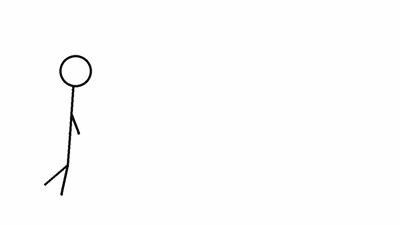
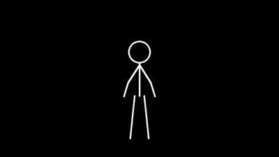
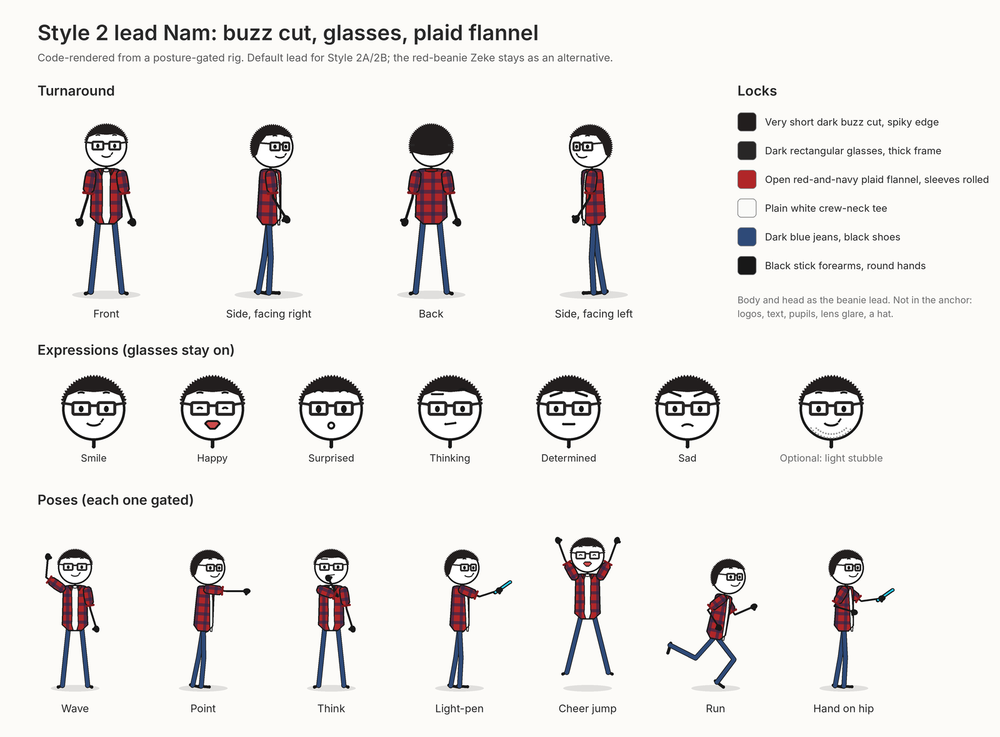
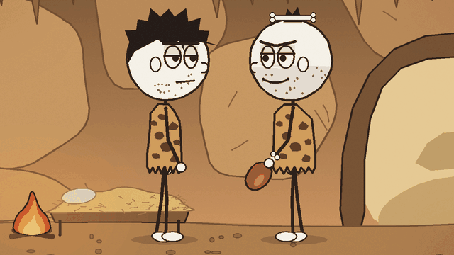
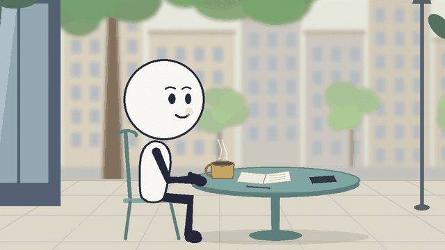

<!-- readme:hero -->

<div align="center">

[Tiếng Việt](README.vi.md) · [**English**](README.en.md) · [日本語](README.ja.md) · [한국어](README.ko.md) · [Português do Brasil](README.pt-BR.md)

# Motion-Graphics Stickman Animation Style Library

**Turn an idea into a polished stickman video with a consistent visual style.**

[](https://github.com/kaomei/stickman-video-director/stargazers)


</div>

<div align="center">

I'm testing popular stickman animation styles from across the web and sharing the workflows here, free and open source. Install the Skill, give your assistant a topic, and get a script, a storyboard, and a segment spec for each part of the video to build as motion graphics, with narration and sound effects.

<strong>Next time you want to make a stickman animation, start here.</strong> For **YouTube explainers, TikTok videos, workplace and motivational stories, educational content, and punchy shorts about everyday life.**

</div>

<table width="100%">
<tr>
<td width="50%" align="center">
<strong>Style 2 default lead</strong><br>
<a href="#lead-character-preview"></a>
</td>
<td width="50%" align="center">
<strong>Đông Hồ Folk Print</strong><br>
<a href="#experimental-styles"></a>
</td>
</tr>
<tr>
<td width="50%" align="center">
<strong>Chú Tiểu Little Monks</strong><br>
<a href="#experimental-styles"></a>
</td>
<td width="50%" align="center">
<strong>Soft Tech Illustration</strong><br>
<a href="#experimental-styles"></a>
</td>
</tr>
</table>

<div align="center">

**4 styles · 6 visual options · 23 experimental styles · Posture gate · Free and open source**

⭐ **Star it now. Next time you make an animation, skip the blank page.**

[Get started](#quick-start) · [23 new styles](#experimental-styles) · [What this fork adds](#fork-additions) · [Latest updates](#recent-updates)

</div>

<!-- readme:demos -->

<a id="style-gallery"></a>

## Find your style

### Style 1: Minimalist Monochrome

A few lines can explain a big idea. On a pure-white or pure-black canvas, characters, props, and accent colors do the storytelling. A good fit for fast, clear explainers.

- **The look:** Round heads, line limbs, consistent stroke weight, and occasional simple expressions. Up to three vivid accent colors distinguish emotions, risks, or actions. Turn anxiety into a cage or attention into a progress bar.
- **Best for:** Science, psychology, motivation, self-management, business breakdowns, and explaining concepts.
- **Which version?** White backgrounds feel clean and direct; choose black backgrounds for stronger contrast, tension, and emotional impact.

<table width="100%">
<tr>
<td width="50%" align="center"><br><sub>Light: an idea lights up</sub></td>
<td width="50%" align="center"><br><sub>Dark: a jump for joy</sub></td>
</tr>
</table>

<p align="center"><sub>Drawn from code rigs and posture-gated.</sub></p>


---

### Style 2: Modern Pop

In this fork the lead has a short dark buzz cut, dark rectangular glasses, a white short-sleeved button-up shirt, and jeans, on the same body as upstream's lead; upstream's red-beanie, yellow-shirt character is still there if you ask for it. Use a clean tech setting to explain a product, or take the character into bedrooms, streets, and open landscapes for a story.

- **The look:** One recognizable character, two kinds of world. 2A pairs white space and a faint grid with floating glass interfaces and cyan-blue light. 2B uses colorful settings, cinematic lighting, and depth.
- **Best for:** 2A suits AI tools, tech products, tutorials, and feature demos. 2B suits personal growth, everyday situations, adventures, and motivational stories.
- **Which version?** Choose 2A to explain a tool or method; choose 2B to follow a character through an experience.


Here is this fork's default lead, drawn from a code rig that passed the posture gate ([character sheet](docs/lead-character/sheet.png)):

<a id="lead-character-preview"></a>

<p align="center"></p>

<p align="center"></p>

<p align="center"><sub>Nam, the default lead: buzz cut, glasses, white short-sleeved shirt, jeans. Ask for upstream's red-beanie Zeke to use him instead.</sub></p>

---

### Style 3: Prehistoric Sketch / Dark Comedy

Take today's problems back to a world without phones or offices. Caves, animal hides, campfires, and exaggerated expressions turn familiar workplace frustrations and human quirks into stories with a twist.

- **The look:** Rough hand-drawn outlines, white-filled heads, dark stick limbs, animal-hide clothes, and earthy scenery. Character interaction, reaction shots, and comic timing matter. Cast adults, children, or elders to fit the story; every story needn't use the same face.
- **Best for:** Prehistoric what-ifs, workplace satire, observations about human nature, dark comedy, fables, and children's English stories.
- **Why choose it?** For a short setup and an unexpected payoff—especially when modern relationships become absurdly familiar in a prehistoric tribe.

<p align="center"></p>

<p align="center"><sub>A caveman in a hide tunic walks to the campfire and warms his hands. Drawn from code rigs and posture-gated.</sub></p>


---

### Style 4: Cozy Storytelling

A mug you've been saving for a special occasion. A message you feel compelled to answer. An afternoon you finally keep for yourself. Simple characters step into colorful everyday settings, with actions, expressions, and camera work carrying the story.

- **The look:** White-filled round heads, slender bodies, dark stick limbs, and small, natural expressions in full-color 2D cartoon environments. Wide shots establish the place; close-ups catch hesitation or relief; tracking shots keep the story moving.
- **Best for:** Relatable everyday stories, personal growth, relationships, warm moments, habit building, and children's English content.
- **Why choose it?** To help viewers recognize themselves in a small moment. Color and lighting follow the topic: warmth, anxiety, exhaustion, or a fresh start.

<p align="center"></p>

<p align="center"><sub>A walk through the park with a coffee, then a wave outside the cafe. Drawn from code rigs and posture-gated.</sub></p>


---

<a id="experimental-styles"></a>

### Experimental styles: 23 new styles

This fork adds 23 styles. Each has its own cast of original characters, its own rules, and a three-clip sample package that passed the posture gate and the package checks. To use one, ask for an experimental style or name it by its key, for example “make it in the `dong-ho` style”. These styles are `gated`: they have not yet been built into a full video. Each card is a few seconds of motion rendered from that style's own code-drawn rigs, which passed the posture gate. “See the cast” opens the full cast. [How to pick one and the checking tools](#fork-additions).

<table width="100%">
<tr>
<td width="50%" align="center" valign="top">
<br>
<strong>Chibi Anime</strong> · <code>chibi-anime</code><br>
Good for: Everyday-life comedy, study tips, relationship sketches, children's content, reaction-heavy shorts<br>
<a href="docs/style-previews/chibi-anime.jpg">See the cast</a>
</td>
<td width="50%" align="center" valign="top">
<br>
<strong>Paper Cutout / Collage</strong> · <code>paper-cutout</code><br>
Good for: Deadpan comedy; gentle stories and children's English<br>
<a href="docs/style-previews/paper-cutout.jpg">See the cast</a>
</td>
</tr>
<tr>
<td width="50%" align="center" valign="top">
<br>
<strong>Whiteboard Doodle</strong> · <code>whiteboard-doodle</code><br>
Good for: Step-by-step explainers, habits and ideas built up piece by piece, light social stories<br>
<a href="docs/style-previews/whiteboard-doodle.jpg">See the cast</a>
</td>
<td width="50%" align="center" valign="top">
<br>
<strong>Watercolor Storybook</strong> · <code>watercolor-storybook</code><br>
Good for: Bedtime stories, children's education, fables, family and nostalgia<br>
<a href="docs/style-previews/watercolor-storybook.jpg">See the cast</a>
</td>
</tr>
<tr>
<td width="50%" align="center" valign="top">
<br>
<strong>Ink-Wash / Sumi-e</strong> · <code>ink-wash</code><br>
Good for: Reflective explainers, habits and patience, craft, folk-tale style stories<br>
<a href="docs/style-previews/ink-wash.jpg">See the cast</a>
</td>
<td width="50%" align="center" valign="top">
<br>
<strong>1950s Mid-Century Limited Animation</strong> · <code>mid-century</code><br>
Good for: Satirical explainers, workplace and money topics, small ensembles of character types<br>
<a href="docs/style-previews/mid-century.jpg">See the cast</a>
</td>
</tr>
<tr>
<td width="50%" align="center" valign="top">
<br>
<strong>Đông Hồ Folk Print</strong> · <code>dong-ho</code><br>
Good for: Vietnamese culture, Tết and village stories, gentle fables<br>
<a href="docs/style-previews/dong-ho.jpg">See the cast</a>
</td>
<td width="50%" align="center" valign="top">
<br>
<strong>Science Lab Explainer</strong> · <code>science-lab</code><br>
Good for: Science and how-it-works explainers for kids and families, hands-on demos<br>
<a href="docs/style-previews/science-lab.jpg">See the cast</a>
</td>
</tr>
<tr>
<td width="50%" align="center" valign="top">
<br>
<strong>Engineering Blueprint</strong> · <code>blueprint</code><br>
Good for: Science, engineering, invention and how-it-works explainers<br>
<a href="docs/style-previews/blueprint.jpg">See the cast</a>
</td>
<td width="50%" align="center" valign="top">
<br>
<strong>Cell-Biology Micro-World</strong> · <code>cell-biology</code><br>
Good for: Immunity, blood, wound-healing and infection explainers for kids and families<br>
<a href="docs/style-previews/cell-biology.jpg">See the cast</a>
</td>
</tr>
<tr>
<td width="50%" align="center" valign="top">
<br>
<strong>Retro Space-Age Astronomy</strong> · <code>retro-space</code><br>
Good for: Space science explainers: orbits, gravity and free fall, the Moon, planets<br>
<a href="docs/style-previews/retro-space.jpg">See the cast</a>
</td>
<td width="50%" align="center" valign="top">
<br>
<strong>Storytime Animation</strong> · <code>youtube-storytime</code><br>
Good for: Funny true stories told by a narrator about their own life<br>
<a href="docs/style-previews/youtube-storytime.jpg">See the cast</a>
</td>
</tr>
<tr>
<td width="50%" align="center" valign="top">
<br>
<strong>Prime-Time Sitcom</strong> · <code>us-sitcom</code><br>
Good for: Dry comedy about everyday life, family and office dynamics<br>
<a href="docs/style-previews/us-sitcom.jpg">See the cast</a>
</td>
<td width="50%" align="center" valign="top">
<br>
<strong>Modern TV Cartoon</strong> · <code>modern-tv-cartoon</code><br>
Good for: Comedy explainers, kids and family stories, small-town adventure told by an ensemble<br>
<a href="docs/style-previews/modern-tv-cartoon.jpg">See the cast</a>
</td>
</tr>
<tr>
<td width="50%" align="center" valign="top">
<br>
<strong>Stylized 3D Family Film</strong> · <code>stylized-3d-family</code><br>
Good for: Warm family stories, kids' explainers, holiday stories<br>
<a href="docs/style-previews/stylized-3d-family.jpg">See the cast</a>
</td>
<td width="50%" align="center" valign="top">
<br>
<strong>Superhero Action Cartoon</strong> · <code>superhero</code><br>
Good for: Short action stories, team-up gags, hero explainers, kids' content (one narrator, no character voices)<br>
<a href="docs/style-previews/superhero.jpg">See the cast</a>
</td>
</tr>
<tr>
<td width="50%" align="center" valign="top">
<br>
<strong>Dino World</strong> · <code>dino-world</code><br>
Good for: Kids' dinosaur science, fossils, "how do we know?" stories<br>
<a href="docs/style-previews/dino-world.jpg">See the cast</a>
</td>
<td width="50%" align="center" valign="top">
<br>
<strong>Toys Come Alive</strong> · <code>toys</code><br>
Good for: Gentle kids' stories, teamwork and sharing, simple physics (balance, towers)<br>
<a href="docs/style-previews/toys.jpg">See the cast</a>
</td>
</tr>
<tr>
<td width="50%" align="center" valign="top">
<br>
<strong>Chú Tiểu Little Monks</strong> · <code>chu-tieu</code><br>
Good for: Mindfulness and kindness lessons, Buddhist-inspired everyday stories, slow-living tips<br>
<a href="docs/style-previews/chu-tieu.jpg">See the cast</a>
</td>
<td width="50%" align="center" valign="top">
<br>
<strong>Vietnamese Web-Comic in Motion</strong> · <code>vn-webcomic</code><br>
Good for: One-joke relatable gags, literal wordplay, neighbourhood slice-of-life<br>
<a href="docs/style-previews/vn-webcomic.jpg">See the cast</a>
</td>
</tr>
<tr>
<td width="50%" align="center" valign="top">
<br>
<strong>Voxel Block World</strong> · <code>voxel-world</code><br>
Good for: Building and teamwork stories, cause and effect, step-by-step assembly<br>
<a href="docs/style-previews/voxel-world.jpg">See the cast</a>
</td>
<td width="50%" align="center" valign="top">
<br>
<strong>Brick-Built Town</strong> · <code>brick-build</code><br>
Good for: How parts fit together, cause and effect, gentle kids' stories, small physics jokes<br>
<a href="docs/style-previews/brick-build.jpg">See the cast</a>
</td>
</tr>
<tr>
<td width="50%" align="center" valign="top">
<br>
<strong>Soft Tech Illustration</strong> · <code>tech-illustration</code><br>
Best for: Software, AI and productivity explainers, app and onboarding stories, helper-robot stories<br>
<a href="docs/style-previews/tech-illustration.jpg">See the cast</a>
</td>
<td width="50%"></td>
</tr>
</table>

<a id="fork-additions"></a>

## What this fork adds

This fork of [kaomei/stickman-video-director](https://github.com/kaomei/stickman-video-director) keeps everything above and adds four things: more styles, a posture gate, a more detailed Golden Hook, and its own Style 2 lead.

### 23 experimental styles

Besides Styles 1–4, the Skill can use 23 experimental styles. Each one has a frozen cast of original characters, its own style rules, and a three-clip sample package.

- **How to pick one:** ask for an experimental style, or name one by its key, for example “make it in the `dong-ho` style”. The Skill offers them only when asked, and tells you each one is `gated`.
- **What `gated` means:** the character rigs passed the posture gate, and the sample package passed the package checks below. These styles have not yet been built into a full video.
- **Where they live:** `skills/directing-stickman-videos/references/styles/<key>.md`, with the sample package in `styles/samples/<key>.md`. The full list is in the “Experimental styles” table of `references/style-catalog.md`.

The table below lists all 23 again. Motion clips and descriptions are under [Experimental styles](#experimental-styles).

| Key | Style | Good for |
|---|---|---|
| `chibi-anime` | Chibi Anime | Everyday-life comedy, study tips, relationship sketches, children's content, reaction-heavy shorts |
| `paper-cutout` | Paper Cutout / Collage | Deadpan comedy; gentle stories and children's English |
| `whiteboard-doodle` | Whiteboard Doodle | Step-by-step explainers, habits and ideas built up piece by piece, light social stories |
| `watercolor-storybook` | Watercolor Storybook | Bedtime stories, children's education, fables, family and nostalgia |
| `ink-wash` | Ink-Wash / Sumi-e | Reflective explainers, habits and patience, craft, folk-tale style stories |
| `mid-century` | 1950s Mid-Century Limited Animation | Satirical explainers, workplace and money topics, small ensembles of character types |
| `dong-ho` | Đông Hồ Folk Print | Vietnamese culture, Tết and village stories, gentle fables |
| `science-lab` | Science Lab Explainer | Science and how-it-works explainers for kids and families, hands-on demos |
| `blueprint` | Engineering Blueprint | Science, engineering, invention and how-it-works explainers |
| `cell-biology` | Cell-Biology Micro-World | Immunity, blood, wound-healing and infection explainers for kids and families |
| `retro-space` | Retro Space-Age Astronomy | Space science explainers: orbits, gravity and free fall, the Moon, planets |
| `youtube-storytime` | Storytime Animation | Funny true stories told by a narrator about their own life |
| `us-sitcom` | Prime-Time Sitcom | Dry comedy about everyday life, family and office dynamics |
| `modern-tv-cartoon` | Modern TV Cartoon | Comedy explainers, kids and family stories, small-town adventure told by an ensemble |
| `stylized-3d-family` | Stylized 3D Family Film | Warm family stories, kids' explainers, holiday stories |
| `superhero` | Superhero Action Cartoon | Short action stories, team-up gags, hero explainers, kids' content (one narrator, no character voices) |
| `dino-world` | Dino World | Kids' dinosaur science, fossils, "how do we know?" stories |
| `toys` | Toys Come Alive | Gentle kids' stories, teamwork and sharing, simple physics (balance, towers) |
| `chu-tieu` | Chú Tiểu Little Monks | Mindfulness and kindness lessons, Buddhist-inspired everyday stories, slow-living tips |
| `vn-webcomic` | Vietnamese Web-Comic in Motion | One-joke relatable gags, literal wordplay, neighbourhood slice-of-life |
| `voxel-world` | Voxel Block World | Building and teamwork stories, cause and effect, step-by-step assembly |
| `brick-build` | Brick-Built Town | How parts fit together, cause and effect, gentle kids' stories, small physics jokes |
| `tech-illustration` | Soft Tech Illustration | Software, AI and productivity explainers, app and onboarding stories, helper-robot stories |

No segment spec names a studio, brand or famous character. Where a style resembles a well-known look, it matches the genre and material only.

### Posture gate and package checks

Animated rigs easily bend a knee the wrong way, stretch a limb, or attach a held prop to the wrong hand. These tools catch that before the build and after rendering. They need only Python 3; reading poses from a rendered clip also needs `pip install mediapipe opencv-python-headless`.

| Tool | What it checks | Run |
|---|---|---|
| Hand ledger | Every held prop stays in one named hand (the character's own left or right) unless a beat passes it; `Hands at start` / `Hands at end` lines chain from clip to clip. | `python3 tools/posture_gate/hand_ledger.py package.md` |
| Package lint | The whole segment spec package: hook placement, the same anchors and voice block in every clip, the five posture negatives, music continuity, no logos or written text, plus the hand ledger. | `python3 tools/package_lint/package_lint.py package.md` |
| Posture gate | Pose tracks exported from each character's rig (or read from a rendered clip): joint limits, limb length, one-frame pops, balance, arms over the torso or face, left and right hands swapping. `--scene` checks several characters in one shot, such as a hand-off. | `python3 tools/posture_gate/posture_gate.py check track.json` |
| Risk sheet | One image per rendered clip with frames around the moments its segment spec marks as risky (passes, turns, falls), for a person to review. | `python3 tools/risk_sheet/risk_sheet.py package.md --clip 2 --video clip2.mp4 -o out/` |

The Skill runs the hand ledger and package lint before it hands over the segment specs. Details: `tools/posture_gate/README.md` and `references/posture-gate.md`.

### Golden Hook in detail

The first stage of the script, the Golden Hook, now has its own card in the director's proposal: a hook pattern, a first frame that already shows the character mid-action with a visible tension, one hook moment by about two seconds that reads with the sound off, and a first spoken line of four to ten words with no greeting. The hook lives in Clip 1's first frame and first beat; it adds no extra line to the spec. See “Golden Hook in detail” in `references/storyboard-template.md`.

### Style 2 lead

Style 2 now defaults to a lead with a short dark buzz cut, thick dark rectangular glasses, a plain white short-sleeved button-up shirt with rolled sleeves, and dark blue jeans. The body and face follow upstream's red-beanie lead. The glasses stay on in every shot. Upstream's red-beanie Zeke stays as the alternative: ask for the beanie character and the Skill uses its anchor instead. The character sheet, poses and motion clip are in `docs/lead-character/` (shown under [Style 2](#lead-character-preview)); every pose passed the posture gate.

<!-- readme:advantages -->

## What the Skill does

It plans the writing and the visuals together—not just a stick figure's appearance.

| Part | What you get |
|---|---|
| **Script** | A hook, progression, and payoff, with narration and a reference translation where needed. |
| **Visuals** | Character actions, props, camera moves, transitions, and sound cues. |
| **Continuity** | Character, prop, and narrator profiles, plus transitions between clips. |
| **Framing** | Composition and shot choices adapted to landscape or portrait. |
| **Revisions** | A proposal to approve before the final segment specs. |

<!-- readme:output -->

First, review the **director's proposal**: narration, scenes, camera work, and sound design. Once you approve it, get a standalone **segment spec** for each roughly ten-second segment to build as motion graphics, plus stitching, transition, and subtitle notes.

The Skill plans the video and writes the segment specs. The video is built as motion graphics: characters are rigs drawn in the chosen style, backgrounds, props and effects are layers, and the narration is recorded or synthesised as its own track; a video editor handles the final assembly, music and subtitles. No API or MCP setup is required for the Skill.

<!-- readme:install -->

<a id="quick-start"></a>

## Get started

### 1. Install the Skill

Send this to your AI assistant:

```text
Install this Skill for me:
https://github.com/kaomei/stickman-video-director
```

<!-- readme:workflow -->

### 2. Give it a topic

Send a topic, draft, or article. For example:

```text
Make a stickman video called “How Did Humans Get Their First Job?”
```

### 3. Follow the guide and approve the plan

**Choose settings → Review the proposal → Request changes → Approve and get your segment specs.**

If you haven't chosen an aspect ratio or style, the Skill asks. Pick landscape `16:9` or portrait `9:16`, then a style from the gallery. It won't ask again for settings you've already given. Videos default to 60 seconds; say “let's try 30 seconds first” for a shorter test.

Next comes the director's proposal: story structure, narration for each segment, character actions, camera work, and sound design. Review the whole plan and request changes before approving the final segment specs.

**“How Did Humans Get Their First Job?” | Landscape 16:9 · Style 3: Prehistoric Dark Comedy · 30 seconds**

Here is an approved sample storyboard. The sample's original narration is preserved:

| Time | Scene and action | Voiceover |
|---|---|---|
| **0–10s: Keeping trouble out** | A caveman drags his stone club into the cave and collapses onto a straw bed. A huge saber-toothed tiger's shadow appears at the entrance. He opens one eye: “Again?” He rolls a boulder across the opening, dusts off his hands, and goes back to bed. End on his satisfied face. | **“Ten thousand years ago, one man finally solved all his problems. He shut them outside.”** |
| **10–20s: The boss finds you** | Just as he closes his eyes, three knocks come from the entrance. The boulder shifts open a crack. The chief leans in, smiling, and offers a spear. The caveman waves it away. Then the chief produces a roasted leg of meat. The caveman sniffs, eyes suddenly wide. Cut outside: spear in hand, he's being nudged toward giant animal tracks. | **“Then someone offered him food… in exchange for a small favor. Congratulations. Employment was invented.”** |
| **20–30s: The price of progress** | He returns to the same cave covered in dust, drops the spear, and holds out his hand for the meat. The chief offers a tiny piece with a professional smile, then presses a whole bundle of spears into his arms, pats his shoulder, and leaves. The caveman looks from the meat to the spears, then slowly at the camera. He lies back down, but the spears jab him upright. | **“The reward got smaller. The workload got bigger. And somehow… they called that progress.”** |

Don't like a line or a scene? Say what to change. Final segment specs come only after your approval. This 30-second example produces three roughly ten-second specs covering characters, action, camera work, narration, and audio.

### 4. Build the segments and edit your video

Build each segment from its spec: rig each character once from its description, key the three beats, and render. Export each character's pose track and run the posture gate before the final render. Record the narration once for the whole video, then assemble the clips in CapCut or another editor and add music, sound effects and subtitles. A 30-second video usually has three roughly ten-second segments; a 60-second video has six.

Style 2's lead comes with a sample rig in `docs/lead-character/` (`render.py`); the experimental styles have character sheets and sample motion clips in `docs/style-previews/`. The Skill is free.

<!-- readme:reliability -->

## A few practical tips

<!-- readme:platforms -->

**Landscape or portrait?**

| Format | Good for | Composition |
|---|---|---|
| `9:16` | YouTube Shorts, TikTok, Instagram Reels | Vertical action, a central subject, and mobile-safe framing |
| `16:9` | YouTube and landscape educational videos | Lateral movement, wider scenes, and side-by-side comparisons |

Use it for faceless explainers, history and business topics, personal growth, everyday stories, and product demos. English narration with bilingual subtitles added later also works for English-learning content, short dramas, and close-reading videos. Durations can be any multiple of ten seconds: 30 seconds, 60 seconds, 90 seconds, three minutes, and beyond.

- Keep character, prop, and narrator profiles consistent across the whole video. Choose any voice changes in the proposal first.
- If one clip's character or props drift, fix the rig or the keys and re-render that clip rather than remaking everything.
- Improve the writing without inventing facts, statistics, or product claims.

<a id="recent-updates"></a>

## Latest updates

- **2026-10-22:** The Skill now builds videos as motion graphics only: Phase B is a segment spec per segment, the posture gate runs on pose tracks exported from the rigs after rendering, and the narration is recorded once for the whole video. The old demo clips were removed from the homepage.
- **2026-10-22:** New experimental style `tech-illustration` (Soft Tech Illustration): a soft 2.5D tech explainer look with a chibi developer team and a robot sidekick.
- **2026-10-20:** This fork adds 22 experimental styles, the posture gate with the hand ledger and package lint, and the detailed Golden Hook card. Style 2 now has a buzz-cut, glasses-wearing default lead. See [What this fork adds](#fork-additions).
- **2026-10-15:** Refined the Chinese homepage, installation steps, and examples; added lighter previews and a Star History chart. Skill rules unchanged.
- **2026-10-14:** Added Style 4, Cozy Storytelling, with train-station and café examples.
- **2026-10-13:** Refined Style 1's character descriptions and current-pose constraints.
- **2026-10-12:** Improved shared voice-consistency rules and added prehistoric and community examples.

Already installed? Homepage changes alone don't require a reinstall. Update the Skill if you want Style 4 or installed before the character and voice-rule changes.

<!-- readme:contribute -->

## What should we add next?

These styles are planned, not available yet:

- **Mixed-media worlds** — Exploring 2D stick figures in richer environments.
- **Style 5: Blackboard Explainer** — Lessons and talks with blackboard interaction.
- **Style 6: Illustrated Storybook** — Fairy tales, fables, and children's stories.
- **Style 7: Graffiti Action** — Fight scenes, short action films, and combos.
- **Style 8: Two-Character Sitcom** — Banter, everyday misunderstandings, and workplace twists.
- **Style 9: Card-Game Adventure** — Level-ups, monster battles, and game-like storytelling.

Suggest a style, share your work, or report a problem in [Issues](https://github.com/kaomei/stickman-video-director/issues). For style requests, include a reference and a topic you'd like to try. For submissions, include the video, style used, and an author link so we can credit you.

## Star History

⭐ **If this library saved you time planning scripts or fixing broken characters, consider giving it a Star. It'll be here when you're ready to make your next video.**

I'm [Kaomei](https://x.com/CrazyKaomei). I'll keep testing styles and sharing useful styles, workflows, and the mistakes worth avoiding—all for free. Less time wrestling with tools, more time for the stories you actually want to tell.

<div align="center">
<a href="https://www.star-history.com/?repos=kaomei%2Fstickman-video-director&amp;type=date">
  <picture>
    <source media="(prefers-color-scheme: dark)" srcset="https://api.star-history.com/svg?repos=kaomei/stickman-video-director&amp;type=Date&amp;theme=dark">
    <source media="(prefers-color-scheme: light)" srcset="https://api.star-history.com/svg?repos=kaomei/stickman-video-director&amp;type=Date">
    
  </picture>
</a>
</div>

## License

Released under the [MIT License](LICENSE). You can use, modify, redistribute, and use the project commercially. Keep the copyright and license notice when distributing the project or substantial portions of it.

Provided “as is,” without warranty. See [LICENSE](LICENSE) for the full terms.
