<!-- readme:hero -->

<div align="center">

[**Tiếng Việt**](README.vi.md) · [English](README.en.md) · [日本語](README.ja.md) · [한국어](README.ko.md) · [Português do Brasil](README.pt-BR.md)

# Thư viện phong cách hoạt hình người que bằng AI

**Biến một ý tưởng thành video người que chỉn chu, giữ một phong cách hình ảnh nhất quán.**

[](https://github.com/kaomei/stickman-video-director/stargazers)


</div>

<div align="center">

Dự án thử các phong cách hoạt hình người que phổ biến trên mạng và chia sẻ quy trình làm ở đây, miễn phí và mã nguồn mở. Cài Skill, đưa cho AI một chủ đề, bạn sẽ nhận kịch bản, phân cảnh động và prompt cho lời dẫn và hiệu ứng âm thanh.

<strong>Lần tới muốn làm hoạt hình người que, hãy bắt đầu từ đây.</strong> Dùng cho **video giải thích trên YouTube, video TikTok, chuyện công sở và truyền động lực, nội dung giáo dục, và video ngắn về đời thường.**

</div>

<table width="100%">
<tr>
<td width="50%" align="center">
<strong>Tối giản đơn sắc</strong><br>
<a href="#style-gallery"></a>
</td>
<td width="50%" align="center">
<strong>Công nghệ hiện đại</strong><br>
<a href="#style-gallery"></a>
</td>
</tr>
<tr>
<td width="50%" align="center">
<strong>Hài đen thời tiền sử</strong><br>
<a href="#style-gallery"></a>
</td>
<td width="50%" align="center">
<strong>Chuyện đời thường ấm áp</strong><br>
<a href="#style-gallery"></a>
</td>
</tr>
</table>

<div align="center">

**4 phong cách · 6 lựa chọn hình ảnh · 22 phong cách thử nghiệm · Gate tư thế · Miễn phí, mã nguồn mở**

⭐ **Bấm Star ngay. Lần sau làm hoạt hình, khỏi phải đi tìm prompt.**

[Bắt đầu](#quick-start) · [22 phong cách mới](#experimental-styles) · [Bản fork này thêm gì](#fork-additions) · [Cập nhật mới](#recent-updates) · [Hướng dẫn đầy đủ (tiếng Trung)](https://x.com/CrazyKaomei/status/2102311241046008268)

</div>

<!-- readme:demos -->

<a id="style-gallery"></a>

## Chọn phong cách

### Phong cách 1: Tối giản đơn sắc

Vài nét vẽ đủ để giải thích một ý lớn. Trên nền trắng tinh hoặc đen tuyền, nhân vật, đạo cụ và màu nhấn tự kể chuyện. Hợp với video giải thích nhanh, rõ.

- **Trông thế nào:** Đầu tròn, tay chân bằng nét, độ dày nét đều, thỉnh thoảng có biểu cảm đơn giản. Tối đa ba màu nhấn rực để phân biệt cảm xúc, rủi ro hay hành động. Biến nỗi lo thành cái lồng, sự tập trung thành thanh tiến độ.
- **Hợp với:** Khoa học, tâm lý, truyền động lực, tự quản lý bản thân, phân tích kinh doanh, giải thích khái niệm.
- **Chọn bản nào?** Nền trắng cho cảm giác sạch và thẳng thắn; chọn nền đen khi cần tương phản mạnh, căng thẳng và cảm xúc rõ hơn.

| Phong cách 1A: Đen trên trắng | Phong cách 1B: Trắng trên đen |
|:---:|:---:|
| <!-- demo:light:start --><!-- demo:light:end --> | <!-- demo:dark:start --><!-- demo:dark:end --> |
| Nền trắng · Nhân vật đen | Nền đen · Nhân vật trắng |

---

### Phong cách 2: Hiện đại, vui mắt

Ở bản fork này, nhân vật chính để tóc đinh sẫm màu, đeo kính cận gọng chữ nhật đậm, mặc sơ mi caro đỏ mở cúc ngoài áo thun trắng và quần jeans, giữ nguyên dáng người của nhân vật upstream; nhân vật mũ len đỏ, áo vàng của upstream vẫn dùng được khi bạn yêu cầu. Dùng bối cảnh công nghệ gọn gàng để giải thích một sản phẩm, hoặc đưa nhân vật vào phòng ngủ, đường phố, cảnh thiên nhiên rộng để kể chuyện.

- **Trông thế nào:** Một nhân vật dễ nhớ, hai kiểu thế giới. 2A là khoảng trắng, lưới mờ, giao diện kính trôi nổi và ánh xanh lam. 2B là bối cảnh nhiều màu, ánh sáng điện ảnh và chiều sâu.
- **Hợp với:** 2A cho công cụ AI, sản phẩm công nghệ, hướng dẫn và demo tính năng. 2B cho phát triển bản thân, tình huống đời thường, phiêu lưu và chuyện truyền động lực.
- **Chọn bản nào?** Chọn 2A để giải thích một công cụ hay phương pháp; chọn 2B để theo chân nhân vật qua một trải nghiệm.

| Phong cách 2A: Công nghệ tối giản | Phong cách 2B: Câu chuyện điện ảnh |
|:---:|:---:|
|  |  |
| Khoảng trắng · Lưới mờ · Ánh xanh lam | Bối cảnh nhiều màu · Ánh sáng điện ảnh · Không khí kể chuyện |

Hai clip trên do upstream làm với nhân vật mũ len đỏ. Đây là nhân vật chính mặc định của bản fork, vẽ từ khung xương bằng code và đã qua gate tư thế ([character sheet](docs/lead-character/sheet.png)):

<p align="center">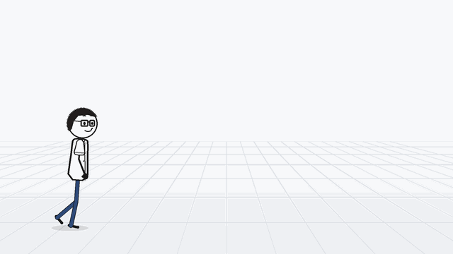</p>

---

### Phong cách 3: Phác họa tiền sử / Hài đen

Mang những rắc rối hôm nay về một thế giới chưa có điện thoại hay văn phòng. Hang động, da thú, lửa trại và biểu cảm cường điệu biến nỗi bực mình nơi công sở và những tật quen của con người thành chuyện có cú twist.

- **Trông thế nào:** Nét viền vẽ tay thô, đầu tô trắng, tay chân que màu tối, quần áo da thú và cảnh sắc màu đất. Tương tác giữa nhân vật, cảnh phản ứng và nhịp hài rất quan trọng. Chọn người lớn, trẻ em hay người già tùy câu chuyện; không cần câu chuyện nào cũng dùng cùng một khuôn mặt.
- **Hợp với:** Giả tưởng thời tiền sử, châm biếm công sở, quan sát về bản tính con người, hài đen, ngụ ngôn và truyện tiếng Anh cho trẻ em.
- **Vì sao chọn nó?** Khi cần một đoạn dẫn ngắn và một cái kết bất ngờ, nhất là khi những mối quan hệ hiện đại hiện ra quen thuộc đến buồn cười trong một bộ lạc tiền sử.

| Ví dụ 1: “Con người có công việc đầu tiên như thế nào?” | Ví dụ 2: “Con người tìm ra lửa” |
|:---:|:---:|
|  |  |
| Hài công sở thời tiền sử | Tìm ra lửa · Tác phẩm cộng đồng |

---

### Phong cách 4: Chuyện đời thường ấm áp

Chiếc cốc bạn để dành cho một dịp đặc biệt. Tin nhắn bạn thấy mình buộc phải trả lời. Một buổi chiều cuối cùng cũng giữ được cho riêng mình. Những nhân vật đơn giản bước vào khung cảnh đời thường đầy màu sắc; hành động, biểu cảm và máy quay kể câu chuyện.

- **Trông thế nào:** Đầu tròn tô trắng, thân mảnh, tay chân que màu tối, biểu cảm nhỏ và tự nhiên trong bối cảnh hoạt hình 2D đủ màu. Cảnh rộng giới thiệu nơi chốn; cận cảnh bắt khoảnh khắc ngập ngừng hay nhẹ nhõm; cảnh máy chạy theo giữ cho câu chuyện tiếp diễn.
- **Hợp với:** Chuyện đời thường dễ đồng cảm, phát triển bản thân, các mối quan hệ, khoảnh khắc ấm áp, xây dựng thói quen và nội dung tiếng Anh cho trẻ em.
- **Vì sao chọn nó?** Để người xem thấy mình trong một khoảnh khắc nhỏ. Màu sắc và ánh sáng đi theo chủ đề: ấm áp, lo âu, kiệt sức hay một khởi đầu mới.

| Ví dụ 1: Lo lắng vì tin nhắn trên đường đi làm | Ví dụ 2: Dành thời gian cho chính mình |
|:---:|:---:|
|  |  |
| Ga tàu · Máy chạy theo · Cận cảnh cảm xúc | Quán cà phê ngoài trời · Ánh sáng ấm · Cử chỉ đời thường |

---

<a id="experimental-styles"></a>

### Phong cách thử nghiệm: 22 phong cách mới

Bản fork này thêm 22 phong cách. Mỗi phong cách có dàn nhân vật gốc riêng, luật riêng và một gói prompt mẫu ba clip đã qua gate tư thế và kiểm tra gói. Muốn dùng, hãy hỏi một phong cách thử nghiệm hoặc gọi đúng mã của nó, ví dụ “làm theo phong cách `dong-ho`”. Các phong cách này đang ở mức `gated`: chưa được kiểm tra trên video tạo ra. Mỗi ô là một đoạn chuyển động vài giây, dựng từ khung xương vẽ bằng code của chính phong cách đó và đã qua gate tư thế; không đoạn nào tạo bằng mô hình video AI. Bấm “Xem dàn nhân vật” để xem cả dàn. [Cách chọn và các công cụ kiểm tra](#fork-additions).

<table width="100%">
<tr>
<td width="50%" align="center" valign="top">
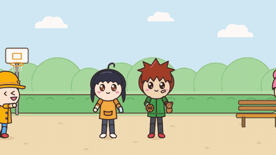<br>
<strong>Anime chibi</strong> · <code>chibi-anime</code><br>
Hợp với: Hài đời thường, mẹo học tập, chuyện tình cảm, nội dung trẻ em, video nhiều phản ứng<br>
<a href="docs/style-previews/chibi-anime.jpg">Xem dàn nhân vật</a>
</td>
<td width="50%" align="center" valign="top">
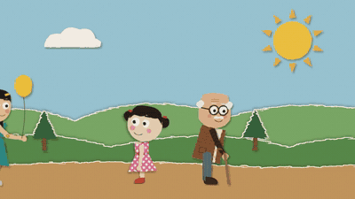<br>
<strong>Cắt dán giấy</strong> · <code>paper-cutout</code><br>
Hợp với: Hài mặt lạnh; chuyện nhẹ nhàng và tiếng Anh cho trẻ em<br>
<a href="docs/style-previews/paper-cutout.jpg">Xem dàn nhân vật</a>
</td>
</tr>
<tr>
<td width="50%" align="center" valign="top">
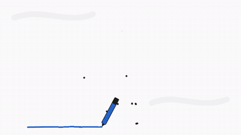<br>
<strong>Vẽ tay trên bảng trắng</strong> · <code>whiteboard-doodle</code><br>
Hợp với: Giải thích từng bước, thói quen và ý tưởng dựng dần từng phần, chuyện xã hội nhẹ<br>
<a href="docs/style-previews/whiteboard-doodle.jpg">Xem dàn nhân vật</a>
</td>
<td width="50%" align="center" valign="top">
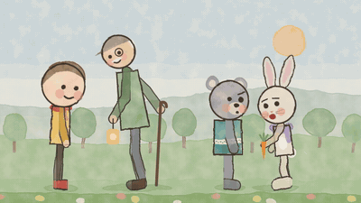<br>
<strong>Sách tranh màu nước</strong> · <code>watercolor-storybook</code><br>
Hợp với: Truyện trước giờ ngủ, giáo dục trẻ em, ngụ ngôn, gia đình và hoài niệm<br>
<a href="docs/style-previews/watercolor-storybook.jpg">Xem dàn nhân vật</a>
</td>
</tr>
<tr>
<td width="50%" align="center" valign="top">
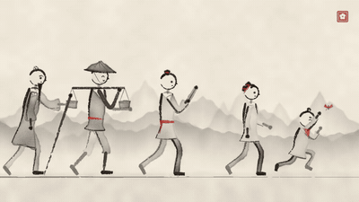<br>
<strong>Tranh thủy mặc</strong> · <code>ink-wash</code><br>
Hợp với: Giải thích mang tính suy ngẫm, thói quen và sự kiên nhẫn, nghề thủ công, chuyện kiểu cổ tích<br>
<a href="docs/style-previews/ink-wash.jpg">Xem dàn nhân vật</a>
</td>
<td width="50%" align="center" valign="top">
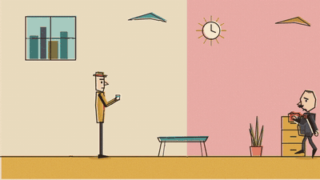<br>
<strong>Hoạt hình giản lược thập niên 1950</strong> · <code>mid-century</code><br>
Hợp với: Giải thích châm biếm, chuyện công sở và tiền bạc, nhóm nhỏ nhân vật điển hình<br>
<a href="docs/style-previews/mid-century.jpg">Xem dàn nhân vật</a>
</td>
</tr>
<tr>
<td width="50%" align="center" valign="top">
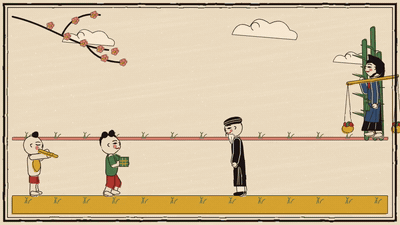<br>
<strong>Tranh Đông Hồ</strong> · <code>dong-ho</code><br>
Hợp với: Văn hóa Việt, chuyện Tết và làng quê, ngụ ngôn nhẹ nhàng<br>
<a href="docs/style-previews/dong-ho.jpg">Xem dàn nhân vật</a>
</td>
<td width="50%" align="center" valign="top">
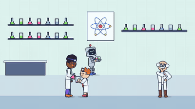<br>
<strong>Phòng thí nghiệm khoa học</strong> · <code>science-lab</code><br>
Hợp với: Giải thích khoa học và cách mọi thứ vận hành cho trẻ em và gia đình, thí nghiệm thực hành<br>
<a href="docs/style-previews/science-lab.jpg">Xem dàn nhân vật</a>
</td>
</tr>
<tr>
<td width="50%" align="center" valign="top">
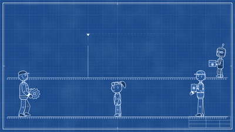<br>
<strong>Bản vẽ kỹ thuật</strong> · <code>blueprint</code><br>
Hợp với: Giải thích khoa học, kỹ thuật, phát minh và cách máy móc vận hành<br>
<a href="docs/style-previews/blueprint.jpg">Xem dàn nhân vật</a>
</td>
<td width="50%" align="center" valign="top">
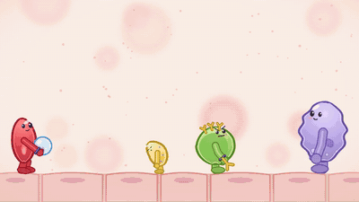<br>
<strong>Thế giới tế bào</strong> · <code>cell-biology</code><br>
Hợp với: Giải thích miễn dịch, máu, lành vết thương và nhiễm trùng cho trẻ em và gia đình<br>
<a href="docs/style-previews/cell-biology.jpg">Xem dàn nhân vật</a>
</td>
</tr>
<tr>
<td width="50%" align="center" valign="top">
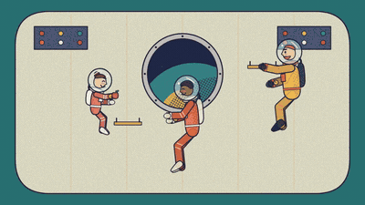<br>
<strong>Thiên văn kiểu thời đại vũ trụ</strong> · <code>retro-space</code><br>
Hợp với: Giải thích khoa học vũ trụ: quỹ đạo, trọng lực và rơi tự do, Mặt Trăng, các hành tinh<br>
<a href="docs/style-previews/retro-space.jpg">Xem dàn nhân vật</a>
</td>
<td width="50%" align="center" valign="top">
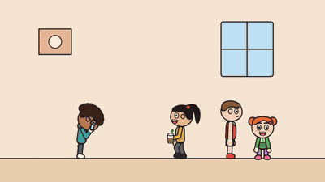<br>
<strong>Hoạt hình kể chuyện</strong> · <code>youtube-storytime</code><br>
Hợp với: Chuyện thật, hài hước, người dẫn kể về chính đời mình<br>
<a href="docs/style-previews/youtube-storytime.jpg">Xem dàn nhân vật</a>
</td>
</tr>
<tr>
<td width="50%" align="center" valign="top">
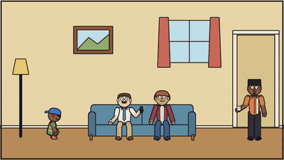<br>
<strong>Sitcom giờ vàng</strong> · <code>us-sitcom</code><br>
Hợp với: Hài khô về đời thường, gia đình và công sở<br>
<a href="docs/style-previews/us-sitcom.jpg">Xem dàn nhân vật</a>
</td>
<td width="50%" align="center" valign="top">
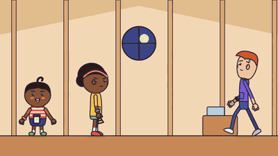<br>
<strong>Hoạt hình truyền hình hiện đại</strong> · <code>modern-tv-cartoon</code><br>
Hợp với: Giải thích hài hước, chuyện trẻ em và gia đình, phiêu lưu thị trấn nhỏ với cả nhóm nhân vật<br>
<a href="docs/style-previews/modern-tv-cartoon.jpg">Xem dàn nhân vật</a>
</td>
</tr>
<tr>
<td width="50%" align="center" valign="top">
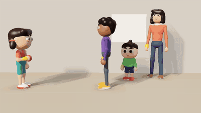<br>
<strong>Phim gia đình 3D cách điệu</strong> · <code>stylized-3d-family</code><br>
Hợp với: Chuyện gia đình ấm áp, giải thích cho trẻ em, chuyện ngày lễ<br>
<a href="docs/style-previews/stylized-3d-family.jpg">Xem dàn nhân vật</a>
</td>
<td width="50%" align="center" valign="top">
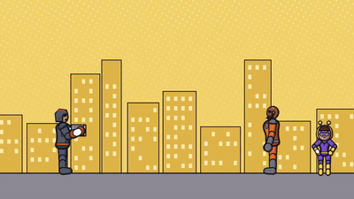<br>
<strong>Hoạt hình siêu anh hùng</strong> · <code>superhero</code><br>
Hợp với: Chuyện hành động ngắn, gag hợp sức, giải thích qua anh hùng, nội dung trẻ em (một người dẫn, nhân vật không nói)<br>
<a href="docs/style-previews/superhero.jpg">Xem dàn nhân vật</a>
</td>
</tr>
<tr>
<td width="50%" align="center" valign="top">
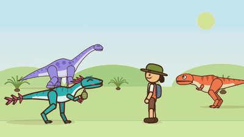<br>
<strong>Thế giới khủng long</strong> · <code>dino-world</code><br>
Hợp với: Khoa học khủng long cho trẻ em, hóa thạch, chuyện “làm sao ta biết?”<br>
<a href="docs/style-previews/dino-world.jpg">Xem dàn nhân vật</a>
</td>
<td width="50%" align="center" valign="top">
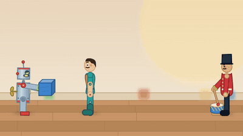<br>
<strong>Đồ chơi sống dậy</strong> · <code>toys</code><br>
Hợp với: Chuyện nhẹ nhàng cho trẻ em, làm việc nhóm và chia sẻ, vật lý đơn giản (thăng bằng, xếp tháp)<br>
<a href="docs/style-previews/toys.jpg">Xem dàn nhân vật</a>
</td>
</tr>
<tr>
<td width="50%" align="center" valign="top">
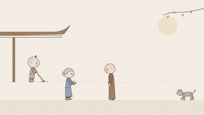<br>
<strong>Chú tiểu</strong> · <code>chu-tieu</code><br>
Hợp với: Bài học chánh niệm và lòng tốt, chuyện đời thường mang tinh thần Phật giáo, mẹo sống chậm<br>
<a href="docs/style-previews/chu-tieu.jpg">Xem dàn nhân vật</a>
</td>
<td width="50%" align="center" valign="top">
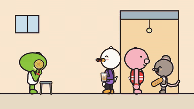<br>
<strong>Truyện tranh mạng Việt chuyển động</strong> · <code>vn-webcomic</code><br>
Hợp với: Gag một câu dễ đồng cảm, chơi chữ theo nghĩa đen, chuyện xóm ngõ<br>
<a href="docs/style-previews/vn-webcomic.jpg">Xem dàn nhân vật</a>
</td>
</tr>
<tr>
<td width="50%" align="center" valign="top">
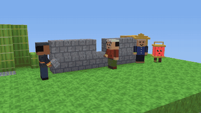<br>
<strong>Thế giới khối voxel</strong> · <code>voxel-world</code><br>
Hợp với: Chuyện xây dựng và làm việc nhóm, nguyên nhân và kết quả, lắp ráp từng bước<br>
<a href="docs/style-previews/voxel-world.jpg">Xem dàn nhân vật</a>
</td>
<td width="50%" align="center" valign="top">
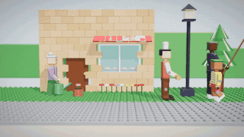<br>
<strong>Thị trấn gạch ráp</strong> · <code>brick-build</code><br>
Hợp với: Các bộ phận khớp với nhau thế nào, nguyên nhân và kết quả, chuyện nhẹ nhàng cho trẻ em, đùa vật lý nhỏ<br>
<a href="docs/style-previews/brick-build.jpg">Xem dàn nhân vật</a>
</td>
</tr>
</table>

<a id="fork-additions"></a>

## Bản fork này thêm gì

Bản fork này của [kaomei/stickman-video-director](https://github.com/kaomei/stickman-video-director) giữ nguyên mọi thứ ở trên và thêm bốn phần: nhiều phong cách hơn, gate kiểm tra tư thế, Golden Hook chi tiết hơn, và nhân vật chính riêng cho Phong cách 2.

### 22 phong cách thử nghiệm

Ngoài Phong cách 1–4, Skill có thể dùng 22 phong cách thử nghiệm. Mỗi phong cách có một dàn nhân vật gốc cố định, luật riêng và một gói prompt mẫu ba clip.

- **Cách chọn:** hỏi một phong cách thử nghiệm, hoặc gọi đúng mã của nó, ví dụ “làm theo phong cách `dong-ho`”. Skill chỉ gợi ý các phong cách này khi bạn hỏi, và sẽ nói rõ mỗi phong cách đang ở mức `gated`.
- **`gated` nghĩa là gì:** khung xương nhân vật đã qua gate tư thế, và gói prompt mẫu đã qua các bước kiểm tra gói bên dưới. Các phong cách này chưa được kiểm tra trên video tạo ra.
- **Nằm ở đâu:** `skills/directing-stickman-videos/references/styles/<mã>.md`, gói mẫu ở `styles/samples/<mã>.md`. Danh sách đầy đủ nằm trong bảng “Experimental styles” của `references/style-catalog.md`.

Bảng dưới đây liệt kê lại cả 22 phong cách. Clip chuyển động và mô tả từng phong cách nằm ở [Phong cách thử nghiệm](#experimental-styles).

| Mã | Phong cách | Hợp với |
|---|---|---|
| `chibi-anime` | Anime chibi | Hài đời thường, mẹo học tập, chuyện tình cảm, nội dung trẻ em, video nhiều phản ứng |
| `paper-cutout` | Cắt dán giấy | Hài mặt lạnh; chuyện nhẹ nhàng và tiếng Anh cho trẻ em |
| `whiteboard-doodle` | Vẽ tay trên bảng trắng | Giải thích từng bước, thói quen và ý tưởng dựng dần từng phần, chuyện xã hội nhẹ |
| `watercolor-storybook` | Sách tranh màu nước | Truyện trước giờ ngủ, giáo dục trẻ em, ngụ ngôn, gia đình và hoài niệm |
| `ink-wash` | Tranh thủy mặc | Giải thích mang tính suy ngẫm, thói quen và sự kiên nhẫn, nghề thủ công, chuyện kiểu cổ tích |
| `mid-century` | Hoạt hình giản lược thập niên 1950 | Giải thích châm biếm, chuyện công sở và tiền bạc, nhóm nhỏ nhân vật điển hình |
| `dong-ho` | Tranh Đông Hồ | Văn hóa Việt, chuyện Tết và làng quê, ngụ ngôn nhẹ nhàng |
| `science-lab` | Phòng thí nghiệm khoa học | Giải thích khoa học và cách mọi thứ vận hành cho trẻ em và gia đình, thí nghiệm thực hành |
| `blueprint` | Bản vẽ kỹ thuật | Giải thích khoa học, kỹ thuật, phát minh và cách máy móc vận hành |
| `cell-biology` | Thế giới tế bào | Giải thích miễn dịch, máu, lành vết thương và nhiễm trùng cho trẻ em và gia đình |
| `retro-space` | Thiên văn kiểu thời đại vũ trụ | Giải thích khoa học vũ trụ: quỹ đạo, trọng lực và rơi tự do, Mặt Trăng, các hành tinh |
| `youtube-storytime` | Hoạt hình kể chuyện | Chuyện thật, hài hước, người dẫn kể về chính đời mình |
| `us-sitcom` | Sitcom giờ vàng | Hài khô về đời thường, gia đình và công sở |
| `modern-tv-cartoon` | Hoạt hình truyền hình hiện đại | Giải thích hài hước, chuyện trẻ em và gia đình, phiêu lưu thị trấn nhỏ với cả nhóm nhân vật |
| `stylized-3d-family` | Phim gia đình 3D cách điệu | Chuyện gia đình ấm áp, giải thích cho trẻ em, chuyện ngày lễ |
| `superhero` | Hoạt hình siêu anh hùng | Chuyện hành động ngắn, gag hợp sức, giải thích qua anh hùng, nội dung trẻ em (một người dẫn, nhân vật không nói) |
| `dino-world` | Thế giới khủng long | Khoa học khủng long cho trẻ em, hóa thạch, chuyện “làm sao ta biết?” |
| `toys` | Đồ chơi sống dậy | Chuyện nhẹ nhàng cho trẻ em, làm việc nhóm và chia sẻ, vật lý đơn giản (thăng bằng, xếp tháp) |
| `chu-tieu` | Chú tiểu | Bài học chánh niệm và lòng tốt, chuyện đời thường mang tinh thần Phật giáo, mẹo sống chậm |
| `vn-webcomic` | Truyện tranh mạng Việt chuyển động | Gag một câu dễ đồng cảm, chơi chữ theo nghĩa đen, chuyện xóm ngõ |
| `voxel-world` | Thế giới khối voxel | Chuyện xây dựng và làm việc nhóm, nguyên nhân và kết quả, lắp ráp từng bước |
| `brick-build` | Thị trấn gạch ráp | Các bộ phận khớp với nhau thế nào, nguyên nhân và kết quả, chuyện nhẹ nhàng cho trẻ em, đùa vật lý nhỏ |

Không prompt nào nêu tên hãng phim, thương hiệu hay nhân vật nổi tiếng. Phong cách nào gợi nhớ một kiểu hình quen thuộc thì chỉ bám theo thể loại và chất liệu.

### Gate tư thế và kiểm tra gói prompt

Mô hình video hay bẻ đầu gối sai chiều, kéo dài tay chân, hoặc chuyển đồ đang cầm sang nhầm tay. Các công cụ dưới đây bắt những lỗi đó trước và sau khi tạo video. Chỉ cần Python 3; muốn đọc tư thế từ video thì cài thêm `pip install mediapipe opencv-python-headless`.

| Công cụ | Kiểm tra gì | Chạy |
|---|---|---|
| Sổ theo dõi tay (hand ledger) | Mỗi đồ vật đang cầm ở yên trong một tay có tên (trái hay phải theo chính nhân vật) trừ khi một nhịp chuyền nó đi; các dòng `Hands at start` / `Hands at end` nối tiếp từ clip này sang clip sau. | `python3 tools/posture_gate/hand_ledger.py package.md` |
| Kiểm tra gói (package lint) | Cả gói prompt: vị trí hook, cùng mô tả nhân vật và khối giọng đọc ở mọi clip, năm câu cấm tư thế, nhạc nối liền, không logo hay chữ viết, cộng thêm sổ theo dõi tay. | `python3 tools/package_lint/package_lint.py package.md` |
| Gate tư thế | Dữ liệu tư thế từ khung xương vẽ bằng code hoặc từ video: giới hạn khớp, độ dài tay chân, giật một khung hình, thăng bằng, tay đè lên thân hoặc mặt, tay trái và tay phải đổi chỗ. `--scene` kiểm tra nhiều nhân vật trong một cảnh, ví dụ khi chuyền đồ. | `python3 tools/posture_gate/posture_gate.py check track.json` |
| Bảng soi rủi ro (risk sheet) | Mỗi clip đã tạo một ảnh, gồm các khung hình quanh những khoảnh khắc prompt đánh dấu là rủi ro (chuyền đồ, quay người, ngã), để người xem lại. | `python3 tools/risk_sheet/risk_sheet.py package.md --clip 2 --video clip2.mp4 -o out/` |

Skill tự chạy sổ theo dõi tay và kiểm tra gói trước khi giao prompt. Chi tiết: `tools/posture_gate/README.md` và `references/posture-gate.md`.

### Golden Hook chi tiết

Giai đoạn đầu của kịch bản, Golden Hook, giờ có thẻ riêng trong đề xuất đạo diễn: một kiểu hook, khung hình đầu đã thấy nhân vật đang hành động với một căng thẳng rõ ràng, một khoảnh khắc hook trước khoảng giây thứ hai mà tắt tiếng vẫn hiểu, và câu nói đầu tiên dài bốn đến mười chữ, không chào hỏi. Hook nằm trong khung hình đầu và nhịp đầu của Clip 1; prompt không có thêm dòng riêng nào. Xem “Golden Hook in detail” trong `references/storyboard-template.md`.

### Nhân vật chính của Phong cách 2

Phong cách 2 giờ mặc định dùng nhân vật tóc đinh ngắn sẫm màu, kính cận gọng chữ nhật đậm, sơ mi flannel caro đỏ xanh than mở cúc, xắn tay, mặc ngoài áo thun trắng trơn, và quần jeans xanh đậm. Dáng người và khuôn mặt theo nhân vật mũ len của upstream. Kính luôn ở trên mặt trong mọi cảnh. Nhân vật mũ len đỏ Zeke của upstream vẫn được giữ làm lựa chọn thay thế: hãy yêu cầu nhân vật mũ len, Skill sẽ dùng anchor của nhân vật đó. Character sheet, các tư thế và clip chuyển động nằm trong `docs/lead-character/`; mọi tư thế đều đã qua gate tư thế và không có gì được tạo bằng mô hình AI.

<!-- readme:advantages -->

## Skill làm được gì

Skill lên kế hoạch cho cả lời lẫn hình, không chỉ vẻ ngoài của một người que.

| Phần | Bạn nhận được |
|---|---|
| **Kịch bản** | Hook, diễn tiến và cái kết, kèm lời dẫn và bản dịch tham khảo khi cần. |
| **Hình ảnh** | Hành động nhân vật, đạo cụ, chuyển động máy quay, chuyển cảnh và gợi ý âm thanh. |
| **Tính liên tục** | Hồ sơ nhân vật, đạo cụ và người dẫn, cùng cách nối giữa các clip. |
| **Khung hình** | Bố cục và lựa chọn cảnh quay theo khổ ngang hay dọc. |
| **Chỉnh sửa** | Một bản đề xuất để duyệt trước khi ra prompt cuối. |

<!-- readme:output -->

Trước hết, bạn xem **đề xuất đạo diễn**: lời dẫn, cảnh, máy quay và thiết kế âm thanh. Khi bạn duyệt, Skill đưa **prompt video Gemini Omni Flash** độc lập cho từng đoạn, kèm ghi chú ghép clip, chuyển cảnh và phụ đề.

Skill lên kế hoạch video và viết prompt. Flow hoặc một công cụ video khác tạo clip; phần mềm dựng video lo việc ghép cuối và phụ đề. Skill không cần cài API hay MCP.

<!-- readme:install -->

<a id="quick-start"></a>

## Bắt đầu

### 1. Cài Skill

Gửi cho trợ lý AI của bạn:

```text
Cài Skill này giúp tôi:
https://github.com/kaomei/stickman-video-director
```

<!-- readme:workflow -->

### 2. Đưa cho nó một chủ đề

Gửi một chủ đề, bản nháp hay bài viết. Ví dụ:

```text
Làm một video người que tên “Con người có công việc đầu tiên như thế nào?”
```

### 3. Làm theo hướng dẫn và duyệt kế hoạch

**Chọn thiết lập → Xem đề xuất → Yêu cầu chỉnh → Duyệt và nhận prompt.**

Nếu bạn chưa chọn khổ hình hay phong cách, Skill sẽ hỏi. Chọn khổ ngang `16:9` hoặc dọc `9:16`, rồi chọn một phong cách trong thư viện. Thiết lập nào bạn đã đưa thì Skill không hỏi lại. Video mặc định dài 60 giây; nói “thử 30 giây trước đã” nếu muốn bản ngắn.

Tiếp theo là đề xuất đạo diễn: cấu trúc câu chuyện, lời dẫn từng đoạn, hành động nhân vật, máy quay và thiết kế âm thanh. Xem cả kế hoạch và yêu cầu chỉnh trước khi duyệt prompt video cuối cùng.

**“Con người có công việc đầu tiên như thế nào?” | Khổ ngang 16:9 · Phong cách 3: Hài đen thời tiền sử · 30 giây**

Đây là phân cảnh đã được duyệt trước khi làm ví dụ ở trên. Lời dẫn gốc của bản mẫu được giữ nguyên:

| Thời gian | Cảnh và hành động | Lời dẫn |
|---|---|---|
| **0–10s: Đóng cửa ngăn rắc rối** | Một người tiền sử kéo cây chùy đá vào hang rồi đổ vật xuống ổ rơm. Bóng một con hổ răng kiếm khổng lồ hiện ở cửa hang. Anh mở một mắt: “Lại nữa à?” Anh lăn một tảng đá chặn cửa, phủi tay rồi ngủ tiếp. Kết bằng khuôn mặt mãn nguyện. | **“Ten thousand years ago, one man finally solved all his problems. He shut them outside.”** |
| **10–20s: Sếp tìm đến** | Vừa nhắm mắt thì có ba tiếng gõ ở cửa hang. Tảng đá hé ra một khe. Tù trưởng ghé vào, mỉm cười, đưa một cây giáo. Người tiền sử xua tay. Tù trưởng liền lấy ra một đùi thịt nướng. Người tiền sử hít hà, mắt bỗng mở to. Cắt ra ngoài: tay cầm giáo, anh bị đẩy dần về phía những dấu chân thú khổng lồ. | **“Then someone offered him food… in exchange for a small favor. Congratulations. Employment was invented.”** |
| **20–30s: Cái giá của tiến bộ** | Anh trở về đúng cái hang ấy, người đầy bụi, thả cây giáo xuống và chìa tay xin thịt. Tù trưởng đưa một miếng bé xíu kèm nụ cười chuyên nghiệp, rồi dúi cả bó giáo vào tay anh, vỗ vai và bỏ đi. Người tiền sử nhìn miếng thịt, nhìn bó giáo, rồi chậm rãi nhìn vào máy quay. Anh nằm xuống lại, nhưng mấy cây giáo chọc anh bật dậy. | **“The reward got smaller. The workload got bigger. And somehow… they called that progress.”** |

Không thích một câu hay một cảnh? Cứ nói muốn đổi gì. Prompt cuối chỉ ra sau khi bạn duyệt. Ví dụ 30 giây này cho ra ba prompt khoảng mười giây, gồm nhân vật, hành động, máy quay, lời dẫn và âm thanh.

### 4. Tạo clip và dựng video

Đưa lần lượt các prompt vào [Google Flow](https://flow.google.com/). Ghép các clip trong CapCut hoặc phần mềm dựng khác, chỉnh chỗ nối và thêm phụ đề. Video 30 giây thường dùng ba prompt khoảng mười giây; video 60 giây dùng sáu.

Lần đầu làm, hãy xem [hướng dẫn sản xuất đầy đủ](https://x.com/CrazyKaomei/status/2102311241046008268). Cũng có [hướng dẫn dùng Flow](https://x.com/CrazyKaomei/status/2093893997223923822?s=20). Cả hai đều bằng tiếng Trung. Skill miễn phí; chi phí tạo video và mô hình có sẵn hay không tùy nền tảng.

<!-- readme:reliability -->

## Vài mẹo thực tế

<!-- readme:platforms -->

**Ngang hay dọc?**

| Khổ | Hợp với | Bố cục |
|---|---|---|
| `9:16` | YouTube Shorts, TikTok, Instagram Reels | Hành động theo chiều dọc, chủ thể ở giữa, khung hình an toàn cho điện thoại |
| `16:9` | YouTube và video giáo dục khổ ngang | Chuyển động ngang, cảnh rộng hơn, so sánh đặt cạnh nhau |

Dùng cho video giải thích không lộ mặt, chủ đề lịch sử và kinh doanh, phát triển bản thân, chuyện đời thường và demo sản phẩm. Lời dẫn tiếng Anh kèm phụ đề song ngữ thêm sau cũng hợp với nội dung học tiếng Anh, phim ngắn và video đọc hiểu. Độ dài có thể là bất kỳ bội số nào của mười giây: 30 giây, 60 giây, 90 giây, ba phút hoặc hơn.

- Giữ hồ sơ nhân vật, đạo cụ và người dẫn nhất quán suốt video. Muốn đổi giọng thì chọn ngay trong đề xuất.
- Nếu nhân vật, đạo cụ hay giọng của một clip bị lệch, chỉnh và thử lại riêng clip đó thay vì làm lại tất cả.
- Viết hay hơn nhưng không bịa sự kiện, số liệu hay tuyên bố về sản phẩm.

<a id="recent-updates"></a>

## Cập nhật mới

- **2026-10-20:** Bản fork thêm 22 phong cách thử nghiệm, gate tư thế cùng sổ theo dõi tay và kiểm tra gói prompt, và thẻ Golden Hook chi tiết. Phong cách 2 có nhân vật chính mặc định tóc đinh, đeo kính. Xem [Bản fork này thêm gì](#fork-additions).
- **2026-10-15:** Chỉnh lại trang chủ, các bước cài đặt và ví dụ; thêm ảnh xem trước nhẹ hơn và biểu đồ Star History. Luật của Skill không đổi.
- **2026-10-14:** Thêm Phong cách 4, Chuyện đời thường ấm áp, với ví dụ ở ga tàu và quán cà phê.
- **2026-10-13:** Chỉnh mô tả nhân vật và ràng buộc tư thế hiện tại của Phong cách 1.
- **2026-10-12:** Cải thiện luật giữ giọng đọc nhất quán, thêm ví dụ tiền sử và ví dụ của cộng đồng.

Đã cài rồi? Chỉ đổi trang chủ thì không cần cài lại. Hãy cập nhật Skill nếu bạn muốn dùng Phong cách 4, các phong cách thử nghiệm và gate tư thế, hoặc đã cài trước các thay đổi về nhân vật và giọng đọc. [Nhật ký thay đổi chi tiết (tiếng Trung)](CHANGELOG.zh-CN.md).

<!-- readme:contribute -->

## Nên thêm gì tiếp theo?

Các phong cách này đang lên kế hoạch, chưa có:

- **Thế giới chất liệu hỗn hợp** — Thử người que 2D trong môi trường phong phú hơn.
- **Phong cách 5: Giải thích trên bảng đen** — Bài giảng và bài nói có tương tác với bảng đen.
- **Phong cách 6: Sách tranh minh họa** — Cổ tích, ngụ ngôn và truyện thiếu nhi.
- **Phong cách 7: Hành động graffiti** — Cảnh đánh nhau, phim hành động ngắn và combo.
- **Phong cách 8: Sitcom hai nhân vật** — Đối đáp, hiểu lầm đời thường và twist công sở.
- **Phong cách 9: Phiêu lưu đấu bài** — Lên cấp, đánh quái và kể chuyện kiểu trò chơi.

Đề xuất phong cách, chia sẻ tác phẩm hoặc báo lỗi trong [Issues](https://github.com/kaomei/stickman-video-director/issues). Khi đề xuất phong cách, kèm một hình tham khảo và chủ đề bạn muốn thử. Khi gửi tác phẩm, kèm video, phong cách đã dùng và đường link tác giả để được ghi công.

## Star History

⭐ **Nếu thư viện này giúp bạn bớt thời gian tìm prompt hay sửa lần tạo hỏng, hãy cân nhắc tặng một Star. Nó sẽ ở đây khi bạn sẵn sàng làm video tiếp theo.**

Thư viện gốc do [Kaomei](https://x.com/CrazyKaomei) làm. Kaomei vẫn tiếp tục thử phong cách và chia sẻ miễn phí những prompt, quy trình và lỗi đáng tránh. Bớt thời gian vật lộn với công cụ, thêm thời gian cho những câu chuyện bạn thật sự muốn kể.

<div align="center">
<a href="https://www.star-history.com/?repos=kaomei%2Fstickman-video-director&amp;type=date">
  <picture>
    <source media="(prefers-color-scheme: dark)" srcset="https://api.star-history.com/svg?repos=kaomei/stickman-video-director&amp;type=Date&amp;theme=dark">
    <source media="(prefers-color-scheme: light)" srcset="https://api.star-history.com/svg?repos=kaomei/stickman-video-director&amp;type=Date">
    
  </picture>
</a>
</div>

## Giấy phép

Phát hành theo [MIT License](LICENSE). Bạn được dùng, sửa, phân phối lại và dùng cho mục đích thương mại. Giữ thông báo bản quyền và giấy phép khi phân phối dự án hoặc phần đáng kể của nó.

Cung cấp “nguyên trạng”, không kèm bảo đảm. Xem toàn bộ điều khoản trong [LICENSE](LICENSE).
