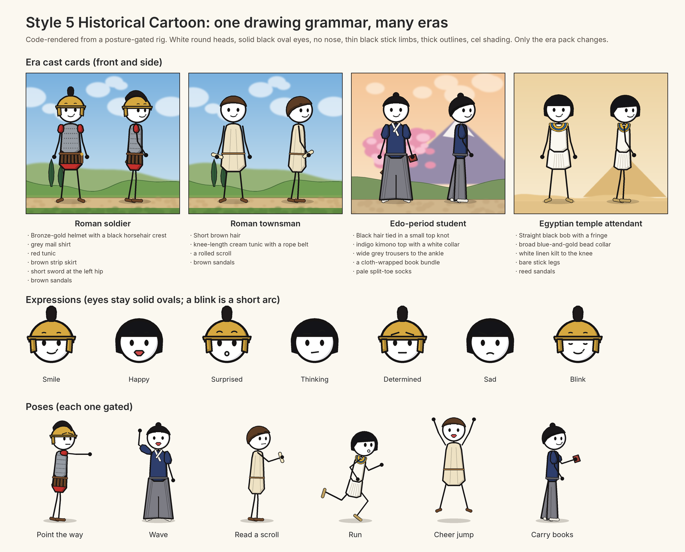
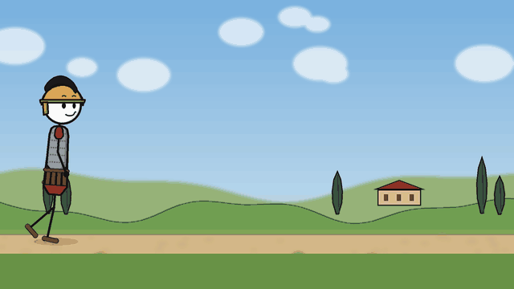

# Style 5 — Historical Cartoon

One drawing grammar, many eras: white filled round heads, solid black oval eyes, expressive brows and mouths, no nose, thin black stick limbs, thick clean outlines and cel shading, in painterly historical settings. The style comes from upstream (`skills/directing-stickman-videos/references/historical-cartoon.md`, visual concept by [@leksautomate](https://github.com/leksautomate)); this folder shows it built as motion graphics.





Everything here is drawn by `render.py` (Pillow) from the same 2D rig as the Style 2 lead (`docs/lead-character/render.py`). Each era only swaps costume layers (helmet, hair, garment, sleeves, skirt or wide trousers, footwear) and the painted set; the joints, limb lengths and head size stay the same, so one walk cycle and one set of gestures serve every era. No AI video or image model was used. Every pose and both shots are saved in `tracks/` and pass `tools/posture_gate/posture_gate.py check` with no errors and no warnings; `tests/verify-historical-cartoon.py` re-checks them.

```bash
python3 docs/style-5/render.py              # redraw sheet.png, motion.gif and tracks/
python3 tests/verify-historical-cartoon.py  # anchor, routing and gate every track
```

The four roles:

| Role | Era | Two non-colour differences |
|---|---|---|
| Roman soldier | Roman | helmet with a crest; strip skirt over a short tunic, sword at the left hip |
| Roman townsman | Roman | short hair, no helmet; knee-length tunic with a rope belt, scroll |
| Edo-period student | Edo Japan | top knot; wide pleated trousers to the ankle, cloth-wrapped book bundle |
| Egyptian temple attendant | Ancient Egypt | straight bob with a fringe; bead collar and a short kilt |

Only the Roman pack is a written era pack in the reference. The Edo and Egypt roles show how far one rig travels; a story set in those eras still drafts and confirms its own era pack and cast cards in Phase A.

Notes on the look:

- Open eyes are always solid ovals; a blink is a short arc and does not redesign the eye.
- Cel shading is one flat shadow band on the side away from the light, plus a thin highlight on metal (the helmet).
- In side view facing right, the character's own right arm and leg are drawn in front, as the posture gate expects. The soldier's sword is on his own left hip, so it is behind the body in that view.
