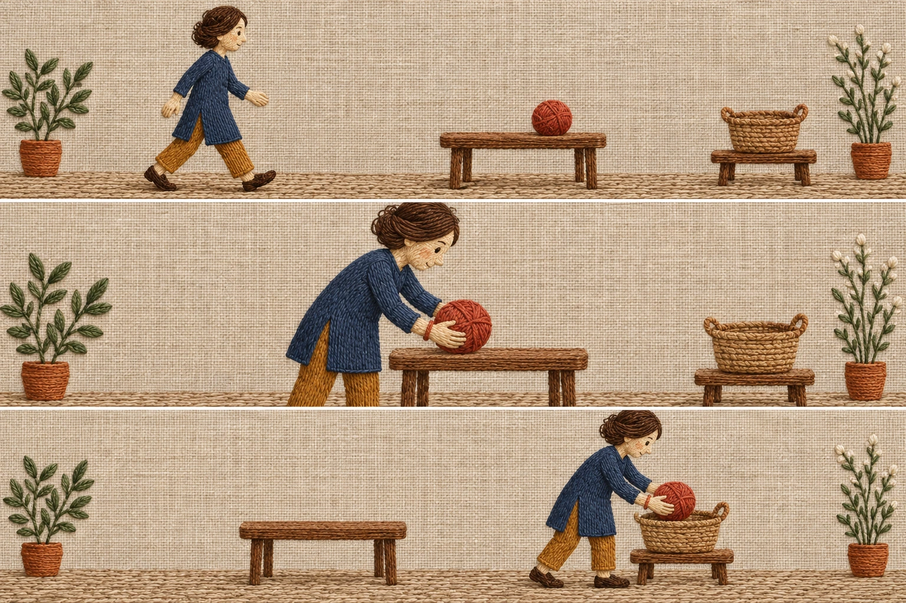
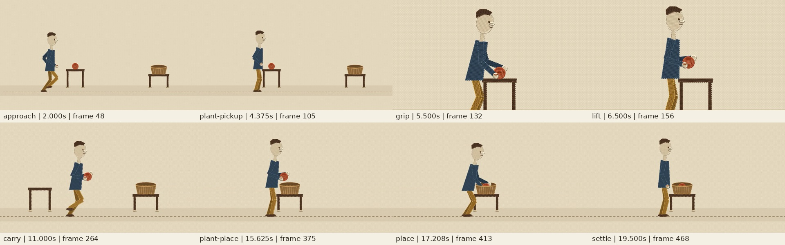

# Embroidered linen: a complete carrying action

May walks to a table, takes a yarn ball with both hands, carries it through the foreground lane and places it inside a basket. A wide establishing shot, close pickup and actual tracking shot keep the action legible. The 20-second silent scene supersedes the original static-gesture study, which was not sufficient motion.

[Action scene, source, versions and review scope](action/README.md). The final textile render and bounded encoded-frame review are complete. Narrow action-gated scope is documented, not owner acceptance or production approval. Do not treat the old ten-second gesture file as the result of this action brief.

[Open the actual 20-second MP4](action/motion/demo.mp4). This is a repository file link, not a promise of inline playback.

## What makes this a distinct material study

Original directional thread fills, short stitched outlines and continuous linen backing. The drawing is layered 2D embroidery-like art, not physical embroidery or cloth simulation. It is neither a glass character recoloured nor a stuffed toy. The [initial image-generated options](concept/options.webp) preceded the original rig, and the action storyboard preceded the action rig. The reference study covers three distinct museum objects and distinguishes observed material cues from inferred mechanisms.

Read [PACK.md](PACK.md), [reference coverage](research.md), [initial frozen brief](concept/brief.md) and [action brief](action/concept/brief.md).

## Historical study, not current motion acceptance

The original [ten-second planted-foot gesture](motion/demo.mp4), [snapshots](gallery/contact-sheet.jpg) and [original documentation](review/original-readme.md) remain available. Its seven sampled moments contain six distinct images because start and rest match. Its posture/lint results and independent 71/100 style score do not accept walking, prop interaction, camera continuity or the revised action scene.

No owner acceptance, audio validation or production approval is recorded. This research directory does not modify the five core styles or the active experimental catalog. No extra service, credentials, paid API, public hosting, dependency or workflow is added.
