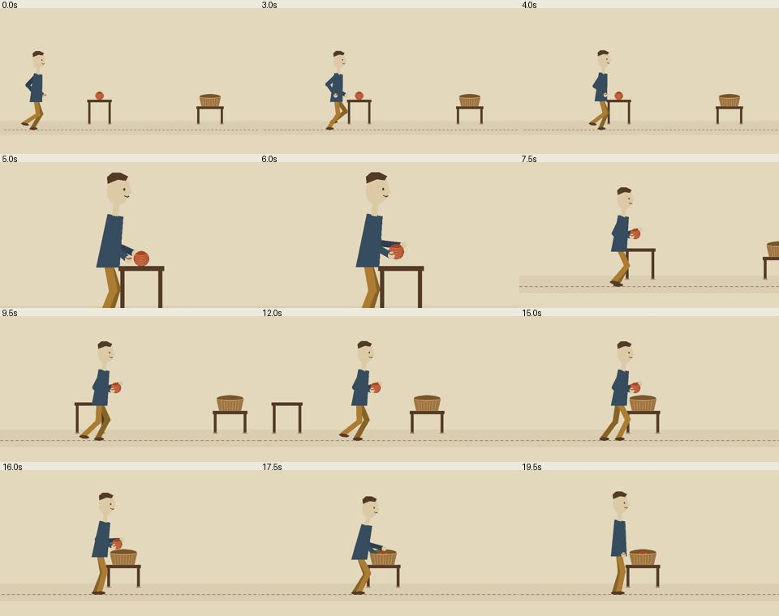

# May carries a yarn ball

A 20-second silent action scene in three shots: approach, pickup, tracking carry and placement. The earlier planted-foot gesture test did not satisfy the motion brief. This replaces its action scope, not its historical files.




[Open the current flat-colour animatic](motion/animatic.mp4). It is a motion draft, not a final material render or production approval.

## Final textured action


[Open the final 20-second video](motion/demo.mp4). 960×540, 24 FPS, 480 frames, silent. Full decode and posture/contact checks pass, and independent review inspected all decoded frames sequentially plus risk windows. This supports only the narrow tested action, not owner acceptance or production readiness. [Review and scoring](review/final-review.md).

## Revision after the first action review

- Furniture feet occupy a rear depth lane, with the figure consistently drawn in the foreground walking lane.
- The neck overlaps the collar and the far hand is visible on the ball's upper contour.
- Approach and carry root movement ease into and out of steps; the tracking camera follows that eased world translation.
- Swing shoes articulate. A trailing foot closes into a planted support stance before reaching and before placement.
- The figure rises after release rather than freezing in a stride.
- Final timing is 20 seconds, organized as two ten-second segments, with three camera shots. The earlier 18-second animatic is retained under review/v1/.

## Evidence boundaries

Exact world-space stance foot contacts, bone lengths and held hand/ball offsets are checked by code. Those checks cannot establish convincing weight, visual collisions, textile fidelity or enjoyable pacing. Camera cuts preserve world-space action and facing direction; the third shot really translates through the scene. This is layered 2D artwork, not a 3D physical simulator. The furniture depth lane is visual staging, not a claim of a collision engine.

The delivered animation is silent. A prospective narrated package may be linted separately, but no voice, music, audio continuity or listening quality is implied. No owner acceptance or production approval has been recorded.

## Reproduce the action draft

```sh
python3 style-research/embroidered-linen/action/src/render_action.py --draft
python3 style-research/embroidered-linen/action/src/gate_action.py --name animatic
python3 style-research/embroidered-linen/action/src/check_action.py --name animatic
```

The same timeline and joint construction drive the textured renderer without `--draft`, at 24 FPS. Do not call a draft's visual review a review of the final encoded file. Inspect the new hash and frames after each material or timing change.

## Reproduce final evidence

```sh
python3 style-research/embroidered-linen/action/src/render_action.py
python3 style-research/embroidered-linen/action/src/gate_action.py --name demo
python3 style-research/embroidered-linen/action/src/check_action.py --name demo
python3 style-research/embroidered-linen/action/src/capture_review.py
```

Capture review regenerates blank checklists. A successful command never signs off a risk window; the recorded manual review belongs to its stated video hash.
