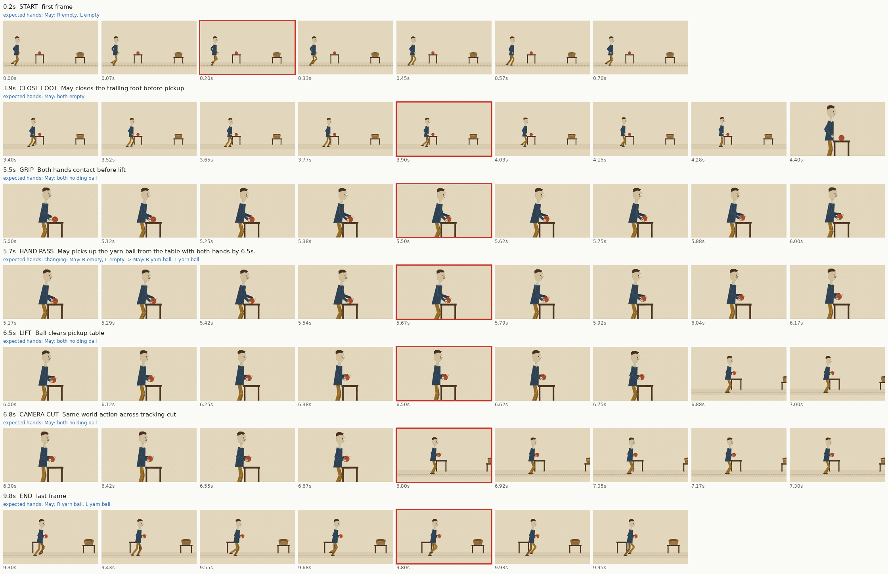

# Clip 1: risky moments

Hands are the character's own: facing the camera, the right hand is on screen left.

| Time | Moment | Beat | Expected hands | OK / FAIL | Note |
|---|---|---|---|---|---|
| 0.2s | start | first frame | May: R empty, L empty | OK | Inspected in decoded risk burst; no new contact, anatomy or continuity defect found. |
| 3.9s | close foot | May closes the trailing foot before pickup | May: both empty | OK | Inspected in decoded risk burst; no new contact, anatomy or continuity defect found. |
| 5.5s | grip | Both hands contact before lift | May: both holding ball | OK | Inspected in decoded risk burst; no new contact, anatomy or continuity defect found. |
| 5.7s | hand pass | May picks up the yarn ball from the table with both hands by 6.5s. | changing: May: R empty, L empty -> May: R yarn ball, L yarn ball | OK | Parser calls pickup a hand pass. This is a two-hand pickup, not a demonstrated hand-to-hand transfer. |
| 6.5s | lift | Ball clears pickup table | May: both holding ball | OK | Inspected in decoded risk burst; no new contact, anatomy or continuity defect found. |
| 6.8s | camera cut | Same world action across tracking cut | May: both holding ball | OK | Inspected in decoded risk burst; no new contact, anatomy or continuity defect found. |
| 9.8s | end | last frame | May: R yarn ball, L yarn ball | OK | Inspected in decoded risk burst; no new contact, anatomy or continuity defect found. |

Also mark FAIL for: an extra or missing limb, a knee or elbow bending backward, a limb changing length, words on screen, or a character whose design changed.

Manual inspection: creator reviewed both actual sheets; independent reviewer inspected both sheets and all 480 final decoded frames. Original full-video SHA-256 bd9cd22120aac0b0c736ef28fb64781f62db572415580f0683404c03d1d5e9fa. These sampled windows do not imply owner acceptance, detailed finger articulation or real-time playback. Current side view places the own-right arm nearer the camera.
