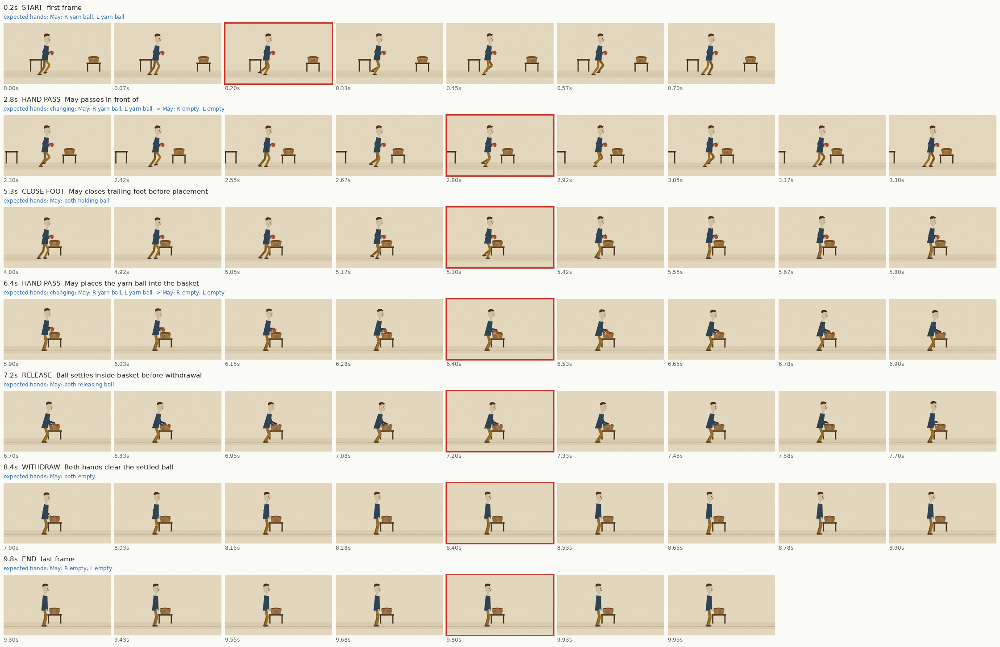

# Clip 2: risky moments

Hands are the character's own: facing the camera, the right hand is on screen left.

| Time | Moment | Beat | Expected hands | OK / FAIL | Note |
|---|---|---|---|---|---|
| 0.2s | start | first frame | May: R yarn ball, L yarn ball | OK | Inspected in decoded risk burst; no new contact, anatomy or continuity defect found. |
| 2.8s | hand pass | May passes in front of | changing: May: R yarn ball, L yarn ball -> May: R empty, L empty | OK | Parser false positive from passes in front of. Both hands retain the ball here; no release or handoff. |
| 5.3s | close foot | May closes trailing foot before placement | May: both holding ball | OK | Inspected in decoded risk burst; no new contact, anatomy or continuity defect found. |
| 6.4s | hand pass | May places the yarn ball into the basket | changing: May: R yarn ball, L yarn ball -> May: R empty, L empty | OK | Inspected in decoded risk burst; no new contact, anatomy or continuity defect found. |
| 7.2s | release | Ball settles inside basket before withdrawal | May: both releasing ball | OK | Inspected in decoded risk burst; no new contact, anatomy or continuity defect found. |
| 8.4s | withdraw | Both hands clear the settled ball | May: both empty | OK | Inspected in decoded risk burst; no new contact, anatomy or continuity defect found. |
| 9.8s | end | last frame | May: R empty, L empty | OK | Inspected in decoded risk burst; no new contact, anatomy or continuity defect found. |

Also mark FAIL for: an extra or missing limb, a knee or elbow bending backward, a limb changing length, words on screen, or a character whose design changed.

Manual inspection: creator reviewed both actual sheets; independent reviewer inspected both sheets and all 480 final decoded frames. Original full-video SHA-256 bd9cd22120aac0b0c736ef28fb64781f62db572415580f0683404c03d1d5e9fa. These sampled windows do not imply owner acceptance, detailed finger articulation or real-time playback. Current side view places the own-right arm nearer the camera.
