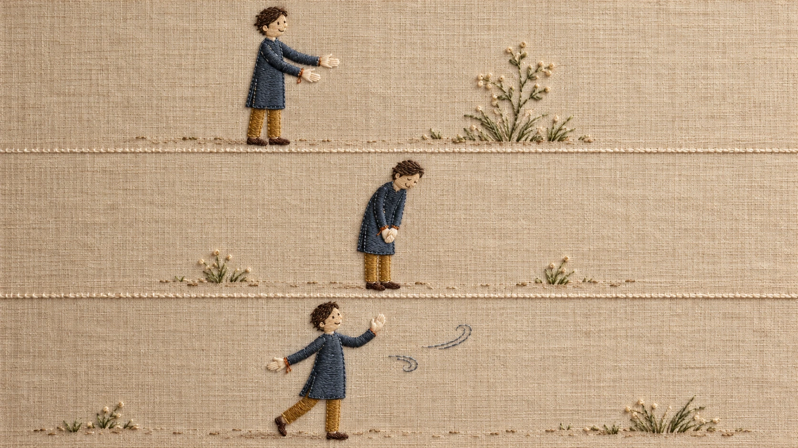
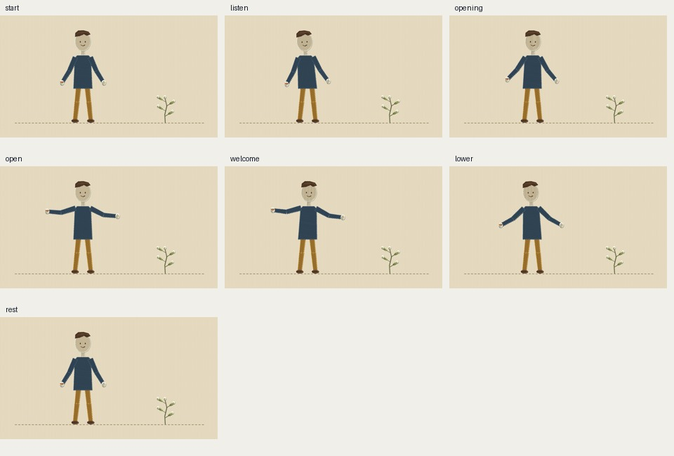

# Embroidered linen motion study

Original character **May** on one continuous woven ground. A ten-second silent local Pillow demo explores a small listening tilt, two open palms and a return to rest. The botanical sprig is original, stationary and untouched.





[Open the actual MP4 demo](../motion/demo.mp4). This is a repository file link, not a promised inline video player.

## What is real here

- Image-generated concept made and inspected before any character code. Three composition options, not three colour variants; option 1 supplies the broad staging. The generated panels are unusually wide, so the coded demo is deliberately recomposed at 16:9 rather than pretending the concept is an exact frame.
- Original procedural cloth backing, directional thread rows, small edge stitches, shallow fibre highlights/shadows, hair curves and original sprig. This is code-drawn 2D embroidery-like art, not physical embroidery, cloth simulation or a reconstruction of the concept photograph.
- An editable joint rig using the repository's front-pose math. Seven state snapshots come directly from seven moments in the same 120-frame demo. Seven is coverage of this sequence, not a universal quota.
- Actual 960×540, 12 FPS, 120-frame H.264 silent video. No Flow, Veo, paid API, audio service, external hosting or new dependency.

## What is not established

Walking, a forward bow, side/rear views, grasping, multiple characters, real textiles, narration and production use are not tested. The sample's prospective voice/audio specification is only a package-lint fixture; the MP4 contains no audio. This study does not claim owner approval or alter the five core styles or 23-pack active catalog.

Read [PACK.md](../PACK.md), [reference coverage](../research.md), [frozen concept brief](../concept/brief.md) and the review files for the actual gate scope and limitations.

## Reproduce

From repository root, with Pillow and ffmpeg already installed:

```sh
python3 style-research/embroidered-linen/src/render.py
ffmpeg -v error -y -framerate 12 -i style-research/embroidered-linen/motion/frames/%04d.png -c:v libx264 -pix_fmt yuv420p -crf 20 -movflags +faststart style-research/embroidered-linen/motion/demo.mp4
python3 tools/package_lint/package_lint.py style-research/embroidered-linen/sample.md --clips 1 --facts style-research/embroidered-linen/sample.facts.md
python3 style-research/embroidered-linen/src/review_sheet.py
python3 style-research/embroidered-linen/src/verify.py
```

The risk-sheet wrapper only clamps extraction to the last actual frame timestamp and adds explicit review moments. It does not change posture or aesthetic scoring. Re-running it regenerates a blank checklist; human visual sign-off must never be inferred from successful extraction.

# Superseded motion brief
The ten-second planted-foot gesture demo is preserved as historical research only. The owner rejected its motion as insufficient on 22 October 2026 and requested locomotion, meaningful actions and camera changes. It does not pass the new brief. Work continues under action/. No new style or PR will be published before a real action sequence is reviewed.
