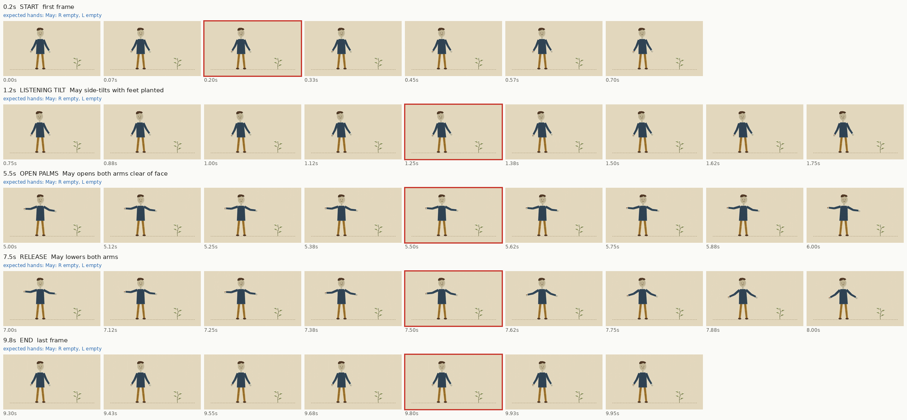

# Clip 1: risky moments

Hands are the character's own: facing the camera, the right hand is on screen left.

| Time | Moment | Beat | Expected hands | OK / FAIL | Note |
|---|---|---|---|---|---|
| 0.2s | start | first frame | May: R empty, L empty |  |  |
| 1.2s | listening tilt | May side-tilts with feet planted | May: R empty, L empty |  |  |
| 5.5s | open palms | May opens both arms clear of face | May: R empty, L empty |  |  |
| 7.5s | release | May lowers both arms | May: R empty, L empty |  |  |
| 9.8s | end | last frame | May: R empty, L empty |  |  |

Also mark FAIL for: an extra or missing limb, a knee or elbow bending backward, a limb changing length, words on screen, or a character whose design changed.
