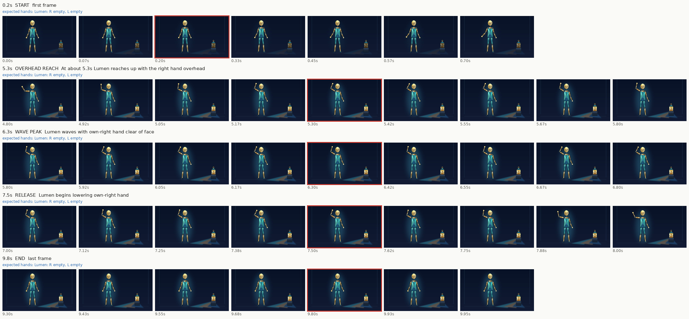

# Clip 1: risky moments

Hands are the character's own: facing the camera, the right hand is on screen left.

| Time | Moment | Beat | Expected hands | OK / FAIL | Note |
|---|---|---|---|---|---|
| 0.2s | start | first frame | Lumen: R empty, L empty | OK | Independent review22Oct2026: empty hands, stable connected limbs, no face cover or scene text in displayed burst. |
| 5.3s | overhead reach | At about 5.3s Lumen reaches up with the right hand overhead | Lumen: R empty, L empty | OK | Independent review22Oct2026: empty hands, stable connected limbs, no face cover or scene text in displayed burst. |
| 6.3s | wave peak | Lumen waves with own-right hand clear of face | Lumen: R empty, L empty | OK | Independent review22Oct2026: empty hands, stable connected limbs, no face cover or scene text in displayed burst. |
| 7.5s | release | Lumen begins lowering own-right hand | Lumen: R empty, L empty | OK | Independent review22Oct2026: empty hands, stable connected limbs, no face cover or scene text in displayed burst. |
| 9.8s | end | last frame | Lumen: R empty, L empty | OK | Independent review22Oct2026: empty hands, stable connected limbs, no face cover or scene text in displayed burst. |

Also mark FAIL for: an extra or missing limb, a knee or elbow bending backward, a limb changing length, words on screen, or a character whose design changed.
