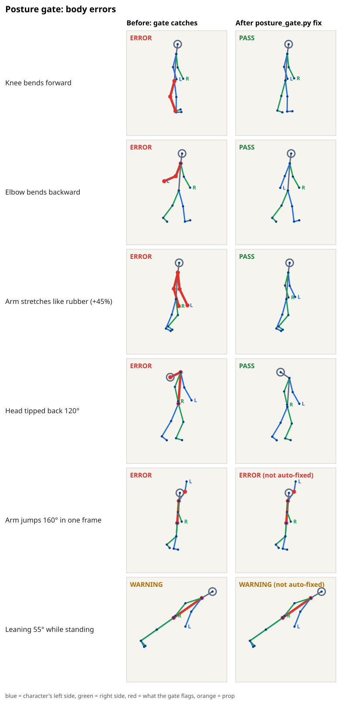
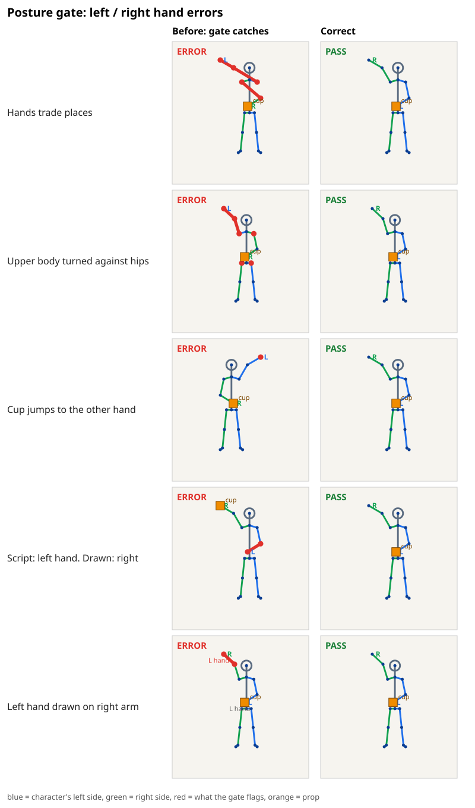

# Posture gate

Catches the body and left/right-hand errors video models make, at three points in the pipeline:

| When | Tool | Blocks? |
|---|---|---|
| Phase B prompts, before generating | `hand_ledger.py package.md` | yes |
| Code-rendered characters (SVG/JS/3D rigs) | `posture_gate.py check track.json` | yes |
| Generated clips | `estimate_pose.py` then `posture_gate.py check` | review only |

`hand_ledger.py` rules are listed in the skill's `references/posture-gate.md`. On a pass between characters: "B takes the X from A" (or "A gives/passes/hands the X to B") is itself A's release, and no separate "A lets go" beat is needed; A's end line must then be empty of X. A release beat is needed when nobody takes the prop (a drop, a put-down) and when a character goes from holding a prop in both hands to one hand ("lets go with his right hand").

Only the Python standard library is needed, except `estimate_pose.py` (`pip install mediapipe opencv-python-headless`).





## What it checks

- **Joint limits** in side view (knee and elbow only fold one way, hip, shoulder, neck, ankle) and front view (knee never bends sideways, leg/head tilt; a frame with `"cross_legged": true`, or with the pelvis and both knees in `supported`, skips the sideways knee and the hip spread, since crossed shins in a flat front view are the pose), from clinical range-of-motion norms in [`joint_limits.json`](joint_limits.json). A track can widen a limit with `"limits_override": {"sagittal": {"hip": {"max": 170}}}`, e.g. for a dancer's high kick.
- **Limb length**: a limb stretching or shrinking against its rest length (rigs), or stretching against the longest length seen (video).
- **Pops and snaps**: a joint turning faster than a person can in one frame (in front view too: an arm flung up in one frame); a knee or elbow flipping bend direction.
- **Zero gravity** (optional): frames marked `"zero_g": true` (and `"airborne": true`) float; with nothing touched (no `contacts` or `supported`) for three frames, the center of mass must drift in a straight line at a steady speed (it may not speed up or turn by more than 0.04 torso-lengths per frame²). Limbs may move, but the hips then move against them.
- **Balance** (warning): center of mass outside whatever touches the ground (feet, knees, pelvis, hands), held for about a fifth of a second or longer (3 frames at 12 fps, so a drawing held on twos passes), so a walk's single-support moments pass. Mark jumps and falls `"airborne": true`; list other supports per frame, `"supported": ["pelvis", "wrist_r", "chair"]` (joints or prop names), or `"supported": true`. A listed knee or head (the bottom of its circle) must reach the ground, and so must a listed wrist or elbow when a knee or foot is listed too (a crouch, a hero landing, a prostration); a lone `wrist_r` can push a wall and a lone `pelvis` sits on a chair, so they are not checked unless the list also names `"floor"` (a floor sit). "Reach" is within 12% of the figure's standing height (its `rest` pose, else the tallest frame), or within `"limb_width"` when that is given; otherwise the frame warns. An ankle lifted off the floor while its toes are down is fine. Gowns and robes drawn as a hull around the leg joints are not checked: clamp them at the ground line in the drawing when the character kneels or sits. A big-headed character can set `"mass": {"head": 0.3}` (segments: head, trunk, upper_arm, forearm, thigh, shank).
- **Head yaw** (3D tracks with a `nose` joint): head turned more than 80° from the body, measured about the neck, so a head tipped back (limbo, knee slide) is not a turned head. In 3D tracks elbows and knees are measured from their true 3D bones, a knee's bend direction from its own foot, and the front-view limits (leg spread sideways, knee bending sideways out of the plane of its thigh and foot) in the pelvis's own frame; the head turn is measured against the shoulders.
- **Left/right**: hands trading places (in side view arms may swing past each other at a human speed), both hands jumping across the body's midline in one frame (a warning), shoulders facing against the hips, a held prop jumping to the other hand (within a clip or across a cut), a prop drawn at the wrong hand, a left hand shape drawn on a right arm. On a `"handoff"` frame the hand newly taking a prop must already be at it on the frame before (within the hold tolerance), so a prop cannot teleport between two still hands.
- **Contact** (optional): `"contacts": {"r": "door"}` (a prop name or a point) fails when that wrist stops more than 0.25 torso-lengths short of it. A big-handed character can widen this with `"contact_tolerance": 0.35` on the track or a frame, or give `"hand_length"` (track units, wrist to fingertip) so the whole hand counts as touching. The tolerance is in torso-lengths, so on a small figure (a toddler) lower it (`0.1`), and put the target point where the hand lands (the chin, the ball's surface or a `"ball.l"` grip point), not at the middle of a big prop. A prop with a second point names it `"<prop>.<part>"` in `props`, and that point can have its own contact: a cane held at `"cane"` with `"cane.tip"` and `"contacts": {"l": "cane", "cane.tip": "ground"}` (the ground is the lowest foot); list `"cane.tip"` in `supported` when the character leans on it.
- **Ground** (optional): with `"ground_y"` (image y of the ground line) on the track or a frame, any joint or the bottom of the head below it fails (a roll or bow sinking into the floor).
- **Four-legged characters**: a track whose frames list `fl`, `fr`, `hl`, `hr` legs (front/hind, the animal's own left/right) as `"<leg>_mid"` (elbow or hock) and `"<leg>_paw"`, hanging from `"shoulder"` (front legs) and `"hip"` (hind legs), with `"neck"`, `"head"` and a tail chain `"tail0"`, `"tail1"`, ... (or `"body_plan": "quadruped"` on the track) is checked as an animal: bones keep their length, all four legs stay drawn (a hidden far leg still gets its points), no bone swings faster than `max_joint_speed`, the body does not jump, a leg never flips its bend, and a straight stiff tail standing like a fifth leg warns. Points may sit at the frame's top level instead of under `"joints"`. Such tracks also join a `--scene` run.
- **Two-handed grips** (optional): a prop carried in both hands can list where each hand grips it, `"<prop>.l"` and `"<prop>.r"`, taken from the prop's own shape (not copied from the wrists, which the gate reports as an empty check); each hand must then reach its grip (`contact_tolerance`), so a big gear held with the hands under it fails even with a wide `hold_tolerance`. Grips one behind the other (side view, both at the same 2D point) are not reported as empty.
- **Solid props** (optional): `"solids": {"block": [w, h]}` (`[w, h, d]` in 3D, track units) is a box of that size centered on the prop's point; a head or body joint inside it fails (a push with the head through the block). Hands may touch it.
- **Arms on the body** (warning, front view): with `"body_width"` (the drawn torso's width at the chest, track units) on the track or a frame, a shoulder joint inside the torso outline, an arm hanging over the body instead of beside it, or a forearm crossing the chest to grip something on the far side (even while it holds it). A body wider at the belly adds `"hip_width"`, or `"body_profile": [[0, half_width_at_pelvis], [0.5, ...], [1, half_width_at_neck]]`; `"limb_width"` gives the drawn forearm's thickness, and `"hand_length"` adds the hand. Every joint angle can be legal while the arms lie on the body, and the joints alone cannot show it when the drawn torso is wider than the shoulders. The torso is measured across its own neck–pelvis axis, so a tilted body (a side bend, a rocking toy) is not misread. An upper arm folded in across the chest ("chicken wing": the elbow well inside the torso outline, the forearm angling down and back out to its own side, the hand holding nothing) warns too; a raised or inward forearm (think, facepalm) or both elbows folded in (crossed arms) is a pose. A busy hand (holding something, or with a contact such as a hand on the knee) skips the hanging-arm test, but its elbow must still not sit over the torso outline: a sitter's arms down the torso edge read as fused onto it. With `"limb_width"` (the drawn arm thickness) the hanging-arm test checks the elbow too, so both tests use the same rule: the arm's edge at the elbow stays outside the outline. Without it only the bone line is tested and a thick arm hugging the torso passes.
- **Inverted elbows** (error, front view, needs `"body_width"`): both elbows folded inside the torso outline while both hands sit out past the shoulders: an IK solver picked the inner elbow. Crossed arms, with the hands in, pass.
- **Arm over face** (warning): in front view a forearm sweeping across the head, a forearm raised past the head lying over it (a cheer with the arms over a big head or hood; a hand at the brow or the face is a pose), or a held prop over the face; in side view the near arm (the right arm when facing right) crossing the face half of the head (the top of the upper arm is not counted, since a big head sits over the shoulder), unless that hand holds a prop at the mouth or has a contact there, and a held prop sitting on the face (a raised ball). The prop's point is its grip; give a long prop its far end as `"<prop>.<part>"` (`"magnifier.lens"`) so that end is checked too. Mark intended moments `"face_cover": true`. In front view `face_cover` lets the hand reach the face, not the arm lie on it: an elbow in the middle of the face, or an elbow pulled across the chest to the far side so the forearm runs diagonally over the face (pushing up glasses with the arm across the body), still fails as an error; bring the hand up with the elbow low and on its own side (`examples/face_cover_arm_across.json`). The face is a circle of half the neck-to-head distance; a big-headed character sets its drawn head radius with `"head_radius"` on the track (or a frame), in track units. Not checked: a hand hidden behind a big head (2D occlusion).

`fix` repairs a rig track by clamping joint angles into range and restoring limb lengths. It does not invent new key poses for pops, balance or hand mix-ups; those still fail after `fix`.

## Several characters in one shot

`posture_gate.py check --scene sol.json kip.json` checks tracks of one shot against each other (same frames, same coordinates; each track has a `"name"`): a prop handed from one character to the other must be at the same place in both hands at the pass, and while both hold it their hands meet and its point is in one place (a big prop gripped at opposite edges, a gear or a stretcher, passes when each holder lists its own grip points `"<prop>.l"` / `"<prop>.r"` and the same `"<prop>"` point); a contact naming another character's joint or prop point (`"contacts": {"r": "Kip.wrist_l"}` for a high five or fist bump, `"Mam.ladle.tip"`) must reach it, a snout, bill or beak (`"snout"`: its length from the head centre, track units, pointing the way the frame faces, or along `"snout_dir": [dx, dy]`) must not reach into another head (an error) or body (a warning), with `"solid_body": true` on both tracks one character's torso or head must not pass through the other's body or limbs (a warning), and one head must not sit inside another (a warning when heads partly overlap, or when one character's held prop or body covers another's face; `"overlap_ok": true` when one passes behind the other). With `--json`, each character's clip result lists the scene issues that name it under `scene_issues` and fails on a scene error, so a summary that reads only the clips does not miss them. A contact naming another character (`"Kip.wrist_l"`) is only checked with `--scene`. Without `--scene`, several tracks are clips in story order.

## Pose track format

```json
{
  "fps": 12,
  "profile": "rig",
  "rest": {"neck": [0, -60], "...": "joints of the rest pose"},
  "frames": [
    {
      "facing": "right",
      "joints": {"head": [x, y], "neck": [x, y], "pelvis": [x, y],
                 "shoulder_l": [x, y], "elbow_l": [x, y], "wrist_l": [x, y],
                 "hip_l": [x, y], "knee_l": [x, y], "ankle_l": [x, y], "toe_l": [x, y],
                 "shoulder_r": "...", "...": "..."},
      "holds": {"cup": "l", "box": ["l", "r"]},
      "props": {"cup": [x, y]},
      "hands": {"l": {"looks_like": "l", "score": 0.95}}
    }
  ]
}
```

Image coordinates, y down. A 3D rig can pass `[x, y, z]` joints (and props) instead: each frame is checked in the body's own side view with true 3D bone lengths, so a limb pointing at the camera is not "shrunk" (`"up_axis"` defaults to `[0, 1, 0]`; coordinates are right-handed as in three.js/glTF, so a character facing +z has its own right hand at -x; set `"handedness": "left"` for Unity-style coordinates). Front-view angle checks (sideways knee, elbow fold) and the torso outline are measured on the 2D drawing, so foreshortened limbs and a chest twisted against the hips read wrong there: export the rig's `[x, y, z]` joints when you have them, or scale a frame's `body_width` by the chest's turn (cos of the twist). If only a camera projection of a 3D rig is available, set `"projected": true`: limbs are then never called shrunk, and stretch is measured against the longest length seen. An arm swing that jumps in one frame of a projected front or back view is only a warning, since a swing toward the camera sweeps a big flat angle for a small real move. Draw `rest` in the same view as the frames. A rig that turns or tips the skull at the top of the neck exports `head` along the face direction (the skull's center, not a point straight above the neck), or the gate sees only part of the neck angle. `_l` / `_r` are the **character's** left and right. A prop carried in both hands is `"holds": {"box": ["l", "r"]}` or `"both"`. Put a held prop's point at the grip, not at its middle: a prop drawn more than 0.6 torso-lengths from its hand fails (`"hold_tolerance": 0.9` on the track or a frame widens this for a big prop), and a long prop's far end goes in its own `"<prop>.<part>"` point. `facing` is `left`, `right`, `front` (toward the camera), `back` or `side`. In side view the near side is the one the character faces toward: facing right (toward screen right), the character's own right arm and leg are toward the camera and drawn in front of the body, the left ones behind it; facing left, the reverse (turn to face screen right and your right shoulder points at the viewer). A renderer that draws the left arm in front while facing right is mirrored; when omitted it is inferred from the feet and shoulder width. With `front` or `back` given, the gate also checks that the right shoulder is on the correct side of the screen, which catches a mirrored figure. Missing joints skip the checks that need them. `holds`, `props`, `hands`, `handoff`, `airborne`, `supported`, `contacts`, `face_cover` and `scale` (camera zoom on a rig) are optional.

Profiles: `rig` (strict, default for rig tracks), `pixel` (rigs snapped to a pixel grid: 1.5 px of rounding allowed on lengths; angles stay as strict as `rig`, so if rounding a 3 px bone trips an angle, gate the pre-snap joints for angles and the snapped joints for lengths), `video` (estimated poses, REVIEW only). In flat front view only a knee bending sideways under a hanging thigh is an error; other front-view hip and knee readings are warnings, since cross-legged sitting and kneeling look the same there, and limbs pointing at the viewer may look short.

[`examples/make_examples.py`](examples/make_examples.py) builds a walk cycle, a front-facing wave with a cup, and one track per bug; [`examples/make_figures.py`](examples/make_figures.py) redraws the figures above.

## Generated clips: what to expect

`estimate_pose.py` uses MediaPipe Pose Landmarker (Apache-2.0). It is trained on real people. On this repository's own Flow demo clips (sampled at 4 fps) it found a usable pose in 3 to 16 of 40 frames per clip, and 5 of 113 for the Style 3 demo. The poses it found were often drawn on scenery, a giant gavel or a beanie rather than the character: in the Style 1 Light, Style 2B and Style 4 café clips we inspected, every flag was an estimator mistake, not a character mistake. That is why the `video` profile reports `REVIEW` and exits 0: open `report.svg`, keep the flags that are real. Use `--strict` to fail instead.

The checks themselves were run on eight CMU Motion Capture clips projected to side view (walking, running, jumping and dance). The six everyday clips pass with no errors; two dance/gymnastics clips trip the hip and ankle limits on high kicks and pivots, which `limits_override` covers.

Pose models that may do better on cartoons (not tested here): RTMPose / DWPose (Apache-2.0, via `rtmlib`) and SDPose (MIT). Their keypoints map to the same track format. Avoid OpenPose (non-commercial licence), Ultralytics YOLO-pose (AGPL) and the AGPL anime pose weights unless that licence fits.
